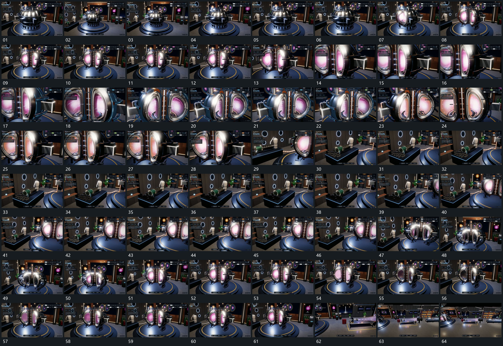

# 101｜原片运动总览

[观看完整原片](video.mp4)

## 运动总览

全片先用围中央组转角靠近再退到共同全貌围中央组转角并小幅推退。曲面外层向两侧拉开露出内层再合拢把曲面外层从中央两侧拉开，使内层显露；取景在打开过程中靠近。内部运动使用内部细线围共同局部弯曲绕行并逐次接续，弯曲细线与点围共同局部持续经过。

取景转向旁侧小组时，沿共同连接让短段依次经过原结构保持沿可见连接让短段依次经过，原中央组仍在边缘。之后围中央组转角靠近再退到共同全貌退回全貌，曲面外层向两侧拉开露出内层再合拢反向合拢再重新打开，末段退到更宽范围，完整空间保持。

## 完整运动段落

以下按原片中的出现顺序引用。建立、内部发展及完成反馈放在同一段中；同时发生的局部动作与运镜写在同一份指令里。不同段之间可以是连续接管，也可以是直接切换，不能仅凭条目相邻认定可直接拼接。重复出现的同类运动采用一次连续代表范围，切片不以逐段无缝覆盖整片为目标。

1. [围绕整体转角靠近，外层展开显出内部活动后合拢退远](mechanisms/m05.md)：观看范围围绕共同中心转动并靠近，曲面外层向两侧打开；内部细线绕行时取景移向相邻连接，短段沿连接依次经过；随后回到中央，外层合拢，退镜恢复整体。

切片保留起始准备、必要内部停顿和完成或明确交接；首尾省略无新发展的等待，持续运动不要求人为停住。以上基于真实源帧序列和重点边界核对，不等同于全片连续声画审片。

## 完整64宫格

