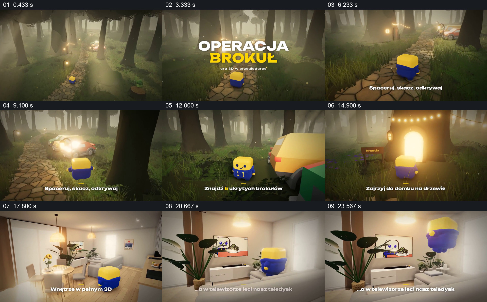

# 跟随角色穿过森林与房屋，展示可探索的空间

- 作品：案例 089《游戏角色的空间探索》（本次概括）。
- 原片范围：00:00.000–00:26.000，含起点、不含终点；[完整原片](../video.mp4)｜[本卡片段](c01.mp4)。
- 观察方式：依据约每秒一次的真实源帧观察，未连续原速观看或听审；声音、语气与完整播放节奏未确认。

## 原画面具体怎样设计

镜头跟随黄蓝色小角色沿林间石路前进，远处路灯与车辆发光；角色靠近绿色花椰菜样物件后，文字提示寻找隐藏物品。角色沿路径来到发光的树屋入口，画面切入明亮室内，继续跟随其在沙发和电视附近活动；最后显示电视里的画面。

## 为什么这样设计，好在哪里

固定跟随同一个小角色，让森林、目标和室内空间构成一次探索，而非互不相关的场景展示；字幕为每个地点补充行动目标。具体交互与游戏功能以影片所示为限。

以上为依据画面的分析，非作者自述；预期观看效果未经观众测试。

## 可直接使用的创意指令

展示可探索的空间时，先让观众认识角色与行进方向，跟随其到达一个可辨目标，再通过入口或视线带入另一空间，展示新的可观察细节；文字只补充实际画面支持的任务，交互能力以真实演示为准。
