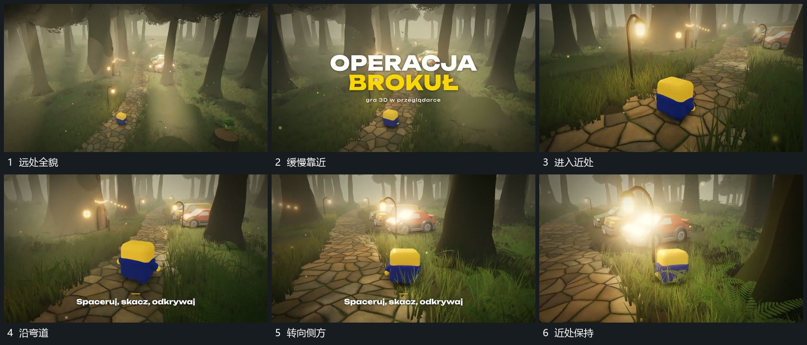

# 沿弯曲路径跟随主形并逐步靠近转角

## 运动指令

围主形沿弯曲路径持续前进，取景随主形改变方向，近侧遮挡经过较快，远层移动较少。主形在推进中保持可辨，并作小幅上下变化；靠近局部后收小推进幅度，再沿侧方转角观察。

## 视频切片

[播放本机制的原片切片](m01.mp4)

覆盖分镜中“远处全貌”至“近处保持”的连续过程，并保留邻近的前后衔接画面；原片中交叠发生的动作一并保留。

## 分镜过程

## 组合与调整

路径与取景方向保持连续；不必把主形固定死在中心，但不能突然跳到另一位置。
