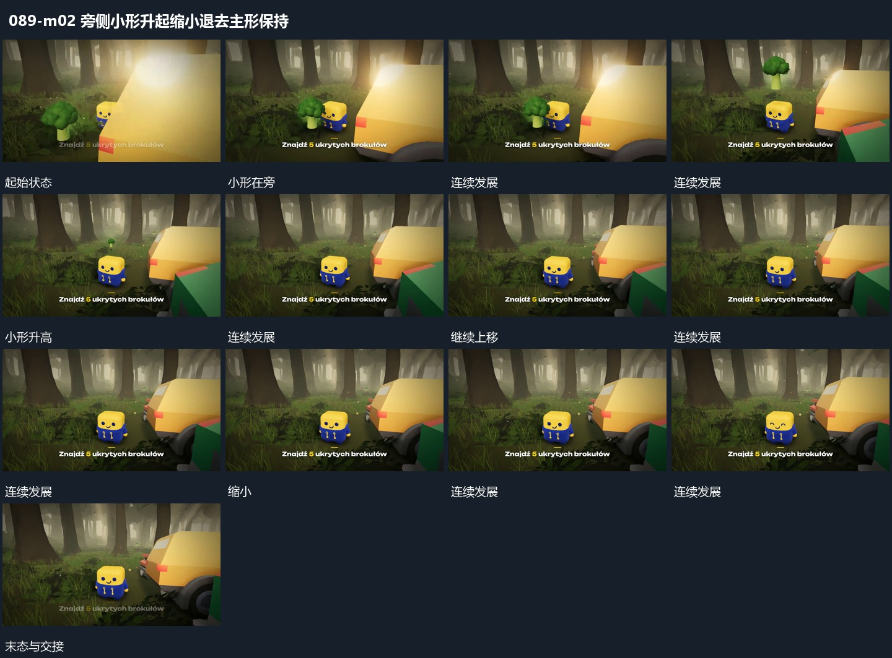

# 旁侧小形升起缩小退去主形保持

## 运动指令

在主形旁侧先建立小形，再让小形向上升起，升高中逐步缩小并退弱。主形与旁侧承载面保持，观察角度仅少量变化；小形退出后留回原空处，不让主形一起离场。

## 视频切片

[播放本机制的原片切片](m02.mp4)

保留起始准备、连续发展和完成或明确交接；首尾按本段运动范围裁切，不拼接、不变速。尾部只保留理解结果所需的展示。

## 分镜过程

## 组合与调整

可换成任意小层，保留与主形旁侧的来源关系；不从升起动作推定取得或奖励含义。
