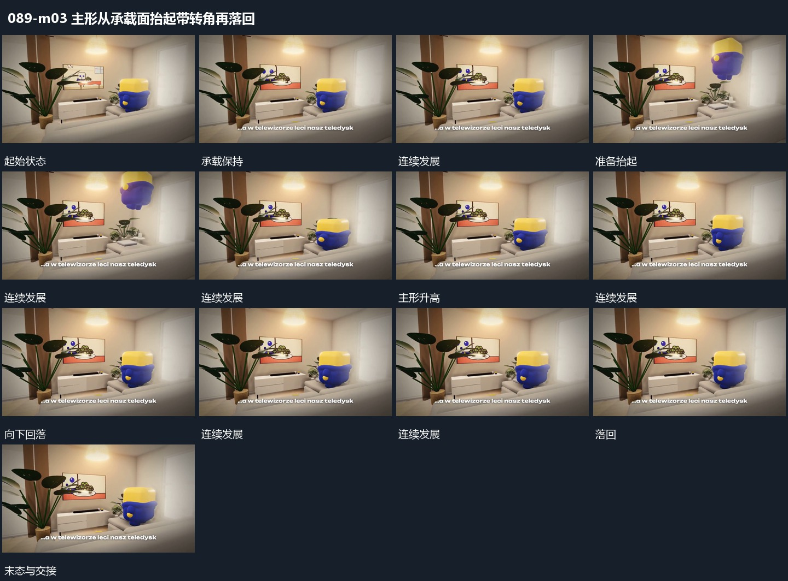

# 主形从承载面抬起带转角再落回

## 运动指令

让主形整体离开承载面向上升高，升高中略改变倾角。到高处后下降并收回转角，重新落到同一承载位置；周围边界不动，接触时主形短暂压低再恢复。可在同一局部重复。

## 视频切片

[播放本机制的原片切片](m03.mp4)

覆盖分镜中“承载保持”至“再次起伏”的连续过程，并保留邻近的前后衔接画面；原片中交叠发生的动作一并保留。

## 分镜过程

## 组合与调整

落点先明确，周围物体不随主形上下移动；循环之间不增加无用途停顿。
