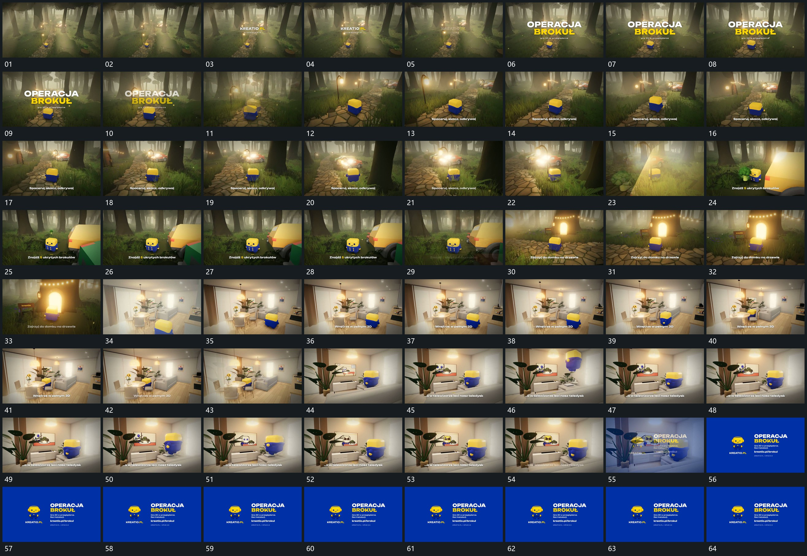

# 089｜原片运动总览

[观看完整原片](video.mp4)

## 运动总览

全片以沿弯曲路径跟随主形并逐步靠近转角沿弯曲路径跟随同一主形，取景逐步靠近并转角。路径旁的小局部用旁侧小形升起缩小退去主形保持升起、缩小并退去。靠近亮开口后清楚换到另一空间，仍保留原主形；新空间继续复用沿弯曲路径跟随主形并逐步靠近转角改变位置与观察角度。

局部近景多次复用主形从承载面抬起带转角再落回，主形抬起、转角并落回同一承载面。最后空间退弱结尾组建立后空底接管并缩定减弱空间并建立结尾组，底层被空底接管后，主形与字行一起缩到稳定范围。

## 完整运动段落

以下按原片中的出现顺序引用。建立、内部发展及完成反馈放在同一段中；同时发生的局部动作与运镜写在同一份指令里。不同段之间可以是连续接管，也可以是直接切换，不能仅凭条目相邻认定可直接拼接。重复出现的同类运动采用一次连续代表范围，切片不以逐段无缝覆盖整片为目标。

1. [沿弯曲路径跟随主形并逐步靠近转角](mechanisms/m01.md)：跟随推进与观察转角交叠

2. [旁侧小形升起缩小退去主形保持](mechanisms/m02.md)：局部抬起后缩退

3. [主形从承载面抬起带转角再落回](mechanisms/m03.md)：抬起转角落回

4. [空间退弱结尾组建立后空底接管并缩定](mechanisms/m04.md)：后层退让前层建立

切片保留起始准备、必要内部停顿和完成或明确交接；首尾省略无新发展的等待，持续运动不要求人为停住。以上基于真实源帧序列和重点边界核对，不等同于全片连续声画审片。

## 完整64宫格

