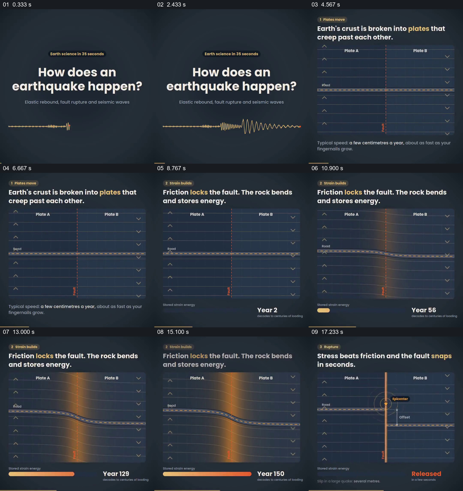

# 在同一断层剖面中累积应力并显示错动

- 作品：案例 055《地震过程的分阶段图解》（索引名称）。
- 原片范围：00:00.000–00:19.000，含起点、不含终点；[完整原片](../video.mp4)｜[本卡片段](c01.mp4)。
- 观察方式：依据整片 64 宫格和约每秒一次的真实源帧观察，未连续原速观看；原片音轨解码采样全为零，完整播放节奏未确认。

## 原画面具体怎样设计

深色图中两侧板块以箭头标记运动，中心断层保持固定；时间数字增长，岩层逐渐弯曲，下方能量条填满。随后断层两侧错开，出现震源及位移标记。

## 为什么这样设计，好在哪里

固定剖面让前后形态能够比较，时间和能量条补充不可直接看见的累积。图是简化模型，地震机制与数量需专业核实。

以上为依据画面的分析，非作者自述；预期观看效果未经观众测试。

## 可直接使用的创意指令

解释缓慢积累与突然变化时，先依据可靠资料建立同一剖面和运动方向，保持参照不变，显示累积量、阈值与真实变化；标明尺度和模型限制。
