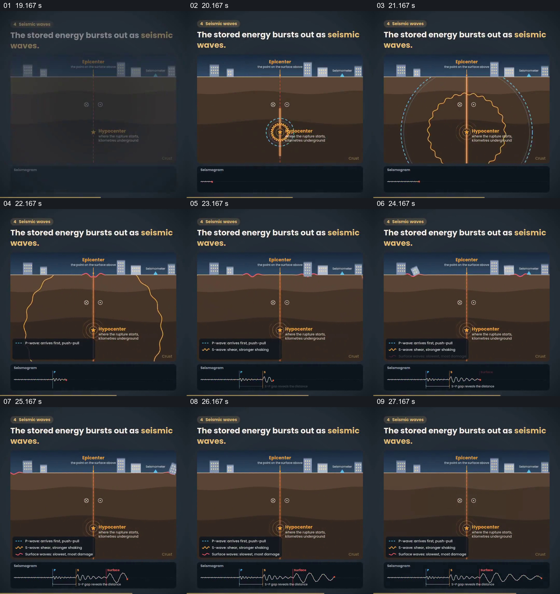

# 从地下震源扩展到地表与波形

- 作品：案例 055《地震过程的分阶段图解》（索引名称）。
- 原片范围：00:19.000–00:28.000，含起点、不含终点；[完整原片](../video.mp4)｜[本卡片段](c02.mp4)。
- 观察方式：依据整片 64 宫格和约每秒一次的真实源帧观察，未连续原速观看；原片音轨解码采样全为零，完整播放节奏未确认。

## 原画面具体怎样设计

剖面显示地下震源和地表建筑，多个波纹向外扩展，建筑出现倾斜；底部同步显示地震记录波形和不同波的文字。

## 为什么这样设计，好在哪里

同一画面连接地下、地表和记录，帮助理解它们处于同一事件。传播尺度和波形为示意，未核实其物理精度。

以上为依据画面的分析，非作者自述；预期观看效果未经观众测试。

## 可直接使用的创意指令

解释传播现象时，以可靠模型标出源、传播方向及观察点，同时显示对应的实际记录或明确示意；尺度、时序和不同波种应经专业校验。
