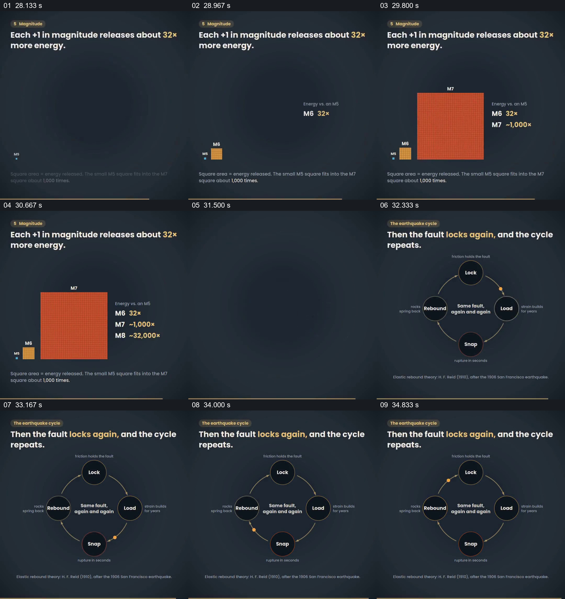

# 用面积对比震级能量，再收成循环图

- 作品：案例 055《地震过程的分阶段图解》（索引名称）。
- 原片范围：00:28.000–00:35.526，含起点、不含终点；[完整原片](../video.mp4)｜[本卡片段](c03.mp4)。
- 观察方式：依据整片 64 宫格和约每秒一次的真实源帧观察，未连续原速观看；原片音轨解码采样全为零，完整播放节奏未确认。

## 原画面具体怎样设计

深色背景中小方块与大橙色方块并列，文字列出不同震级的能量倍数；随后四个节点围成环，标注锁定、加载、断裂和回弹。

## 为什么这样设计，好在哪里

面积对比提供数量级的直观差距，循环图把前面过程收为可回看的阶段。具体倍数及示意的面积比例需核实。

以上为依据画面的分析，非作者自述；预期观看效果未经观众测试。

## 可直接使用的创意指令

说明量级差异时，先核对计算基准，使用与数量关系一致且注明尺度的图形；若总结循环，按真实机制标明阶段和连接，不将示意周期用于预测具体事件。
