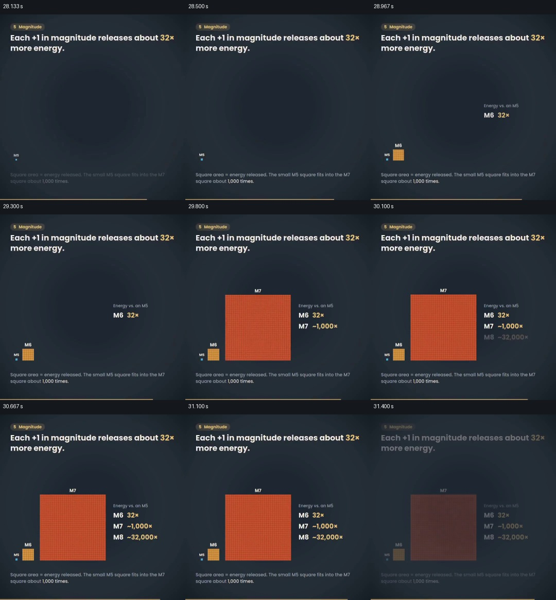

# 把震级差转成同屏可比较的面积

- 作品：案例 055，地震成因图示（库内案例）。
- 原片范围：28.000–31.500 秒；[完整原片](../video.mp4)｜[本卡片段](c03-20261111.mp4)。含起点、不含终点；末段原片音视频流长度约差 26 毫秒。
- 观察方式：查看全片 64 格与本卡九宫格；新拆分范围以原片帧制作分镜。未独立连续原速观看；原片音轨解码采样全为零。科学数据未独立核验，迁移未实测。

## 原画面具体怎样设计

深色背景上方文字说明震级每增加一级对应的能量倍率；下方先出现极小的 M5 方块，随后 M6 方块在旁边出现，右侧列出“32x”。接着更大的 M7 方块占据主要视觉区域，M5、M6 仍保留在其左下方；右侧补充 M7 和 M8 相对 M5 的数字。

底部小字说明方块面积代表能量，观众既看到尺度悬殊，也能通过文字知道比较基准。31.5 秒附近该图退出，下一段开始周期图。

## 为什么这样设计，好在哪里

同一基准的小方块留在大方块旁边，倍数不再只是一个孤立数字；旁边数值解释视觉上过小、难以直接计数的差异。面积说明是必要条件，否则容易将边长误读为倍数。片中数字未对原始数据独立复算，能量示意不等于地震造成的损害。

## 可直接使用的创意指令

当数值有明确基准与倍率时，先让基础单位可辨认，再以同一面积口径展示更大值，保留小值作为参照；把倍率、单位及面积含义写在附近。差距过大时补充数字或局部解释。方块、颜色和排列可变，须保持面积而非边长对应数值。
