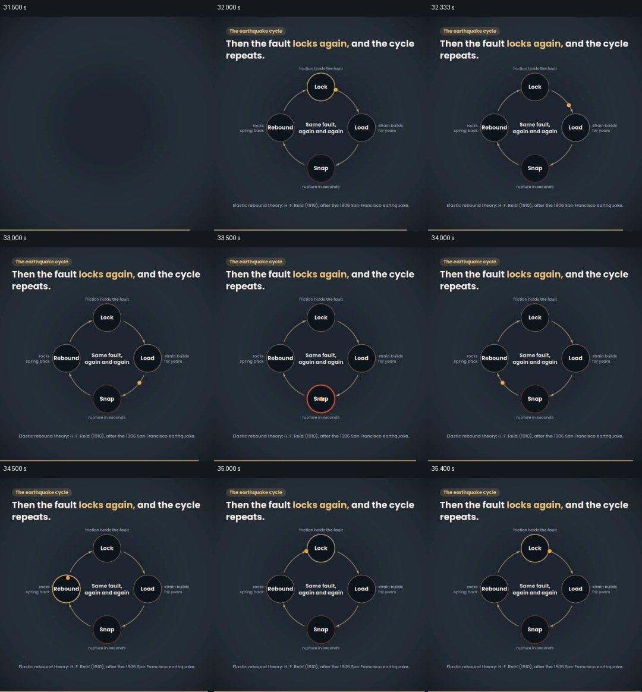

# 把四个状态围成闭环，回扣同一断层的变化

- 作品：案例 055，地震成因图示（库内案例）。
- 原片范围：31.500–35.526 秒；[完整原片](../video.mp4)｜[本卡片段](c04-20261111.mp4)。含起点、不含终点；末段原片音视频流长度约差 26 毫秒。
- 观察方式：查看全片 64 格与本卡九宫格；新拆分范围以原片帧制作分镜。未独立连续原速观看；原片音轨解码采样全为零。科学数据未独立核验，迁移未实测。

## 原画面具体怎样设计

深色页面中央出现四个圆：顶部 Lock、右侧 Load、底部 Snap、左侧 Rebound；弧形箭头将它们按顺序连成闭环，中心写“同一断层反复发生”。每个节点外侧有一句较小的状态说明，底部给出弹性回跳理论的引用文字。

不同源帧中黄色小点落在环的不同位置，节点和箭头整体保持；本卡以完整闭环和中心对象作为结果收束，结束原片。

## 为什么这样设计，好在哪里

四个状态始终同屏，箭头负责关系，中心文字固定了循环发生的对象；观众可回看前后阶段，而不必记住四张独立标题卡。小点为阅读顺序提供提示，但抽样不能确认其完整运动路径。闭环不证明现实断层一定按固定周期发生。

## 可直接使用的创意指令

当过程确实能回到起点时，把同一对象放在持续可见的位置；围绕它布置少量状态节点，用有方向的连接明确先后，并在各项附近写出条件。状态同时可见以便理解返回关系；必要时突出当前节点。数量与形状可变，不得用闭环暗示未经验证的周期性。
