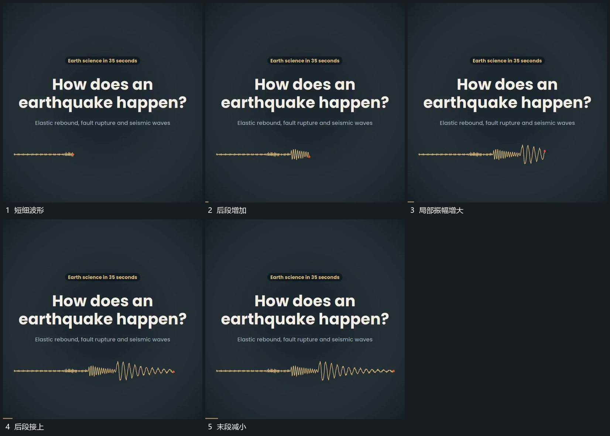

# 波形从左向右延长，振幅增大后逐步收回

## 运动指令

从左侧起点延长波形，端点向右推进。先新增较小起伏，再接入较大起伏，后段逐步减小，已建立线段保留，形成完整可追踪波形。

## 视频切片

[播放本机制的原片切片](m01.mp4)

覆盖分镜中“短细波形”至“末段减小”的连续过程，并保留邻近的前后衔接画面；原片中交叠发生的动作一并保留。

## 分镜过程

## 组合与调整

不推定声音或测量来源，采用可见线形增长。
