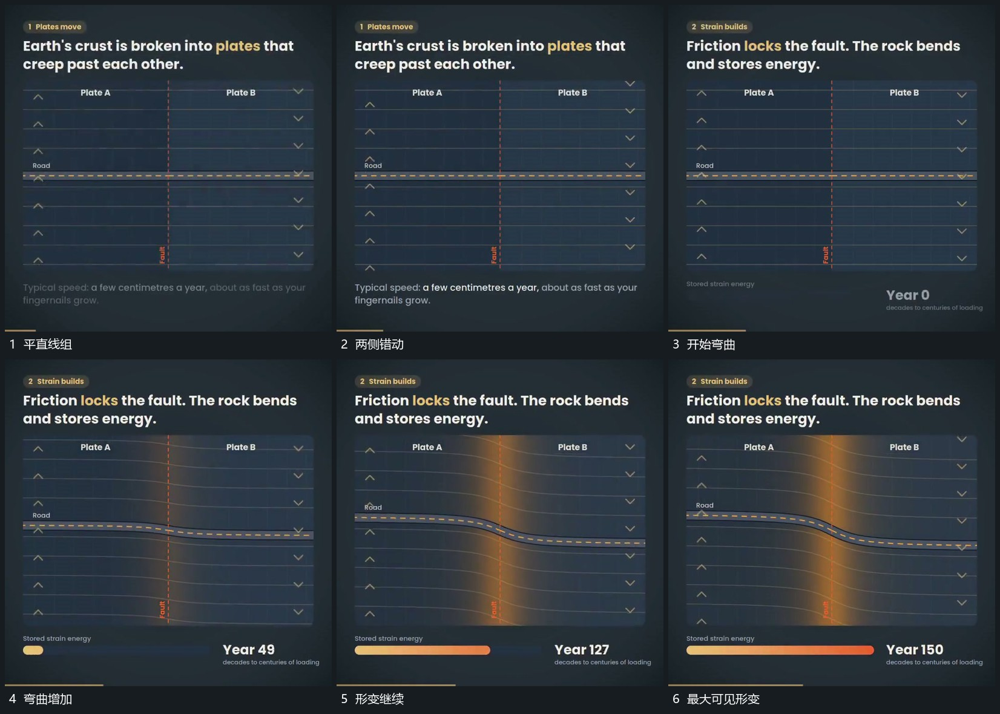

# 分界两侧线组反向错动，中部连线逐渐弯曲

## 运动指令

保留中央分界，两侧线组沿相反方向缓慢错动。中部连线暂时维持连接，逐渐弯曲成跨过分界的形变，下方短条随推进延长，数值增加。

## 视频切片

[播放本机制的原片切片](m02.mp4)

覆盖分镜中“平直线组”至“最大可见形变”的连续过程，并保留邻近的前后衔接画面；原片中交叠发生的动作一并保留。

## 分镜过程

## 组合与调整

只规定相对运动，不继承物理题材或真实受力模型。
