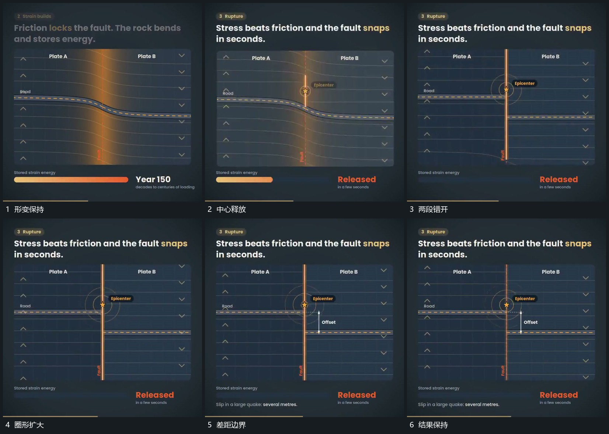

# 弯曲组短促释放成错段，中心圈扩散后补差距边界

## 运动指令

在弯曲组达到稳定形变后短促释放，使两段转成错开位置。中心接入扩散圈，圈增大后退弱，再补出局部差距边界，两段位置稳定。

## 视频切片

[播放本机制的原片切片](m03.mp4)

覆盖分镜中“形变保持”至“结果保持”的连续过程，并保留邻近的前后衔接画面；原片中交叠发生的动作一并保留。

## 分镜过程

## 组合与调整

差距边界晚于实际错开。可用简单线组替代原片物体。
