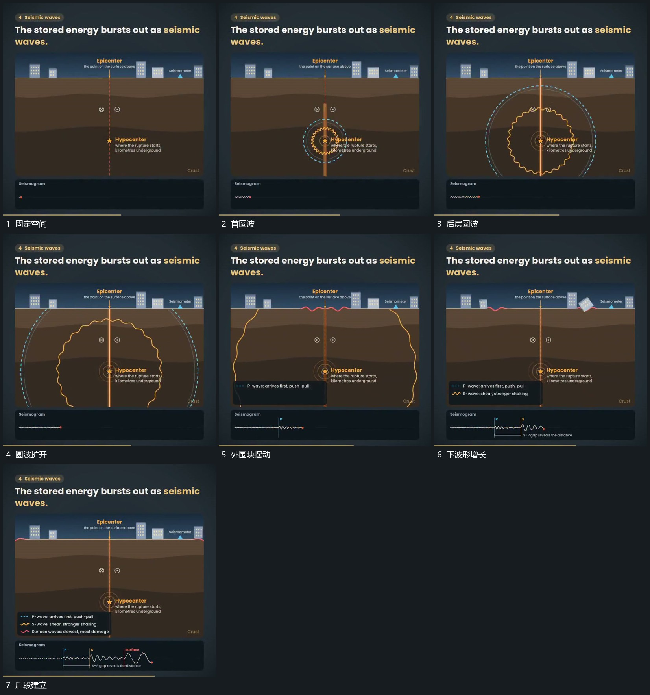

# 中心多层圆波向外扩散，经过后外围块摆动，下方波形接续

## 运动指令

从固定空间的中心点扩出多层圆波，各波先后越向外围。圆波经过后外围小块轻微摆动，下方波形从左向右接续增长，主空间边界保持。

## 视频切片

[播放本机制的原片切片](m04.mp4)

覆盖分镜中“固定空间”至“后段建立”的连续过程，并保留邻近的前后衔接画面；原片中交叠发生的动作一并保留。

## 分镜过程

## 组合与调整

不声称物理传播参数准确。新片应让外围反应确实发生在波经过之后。
