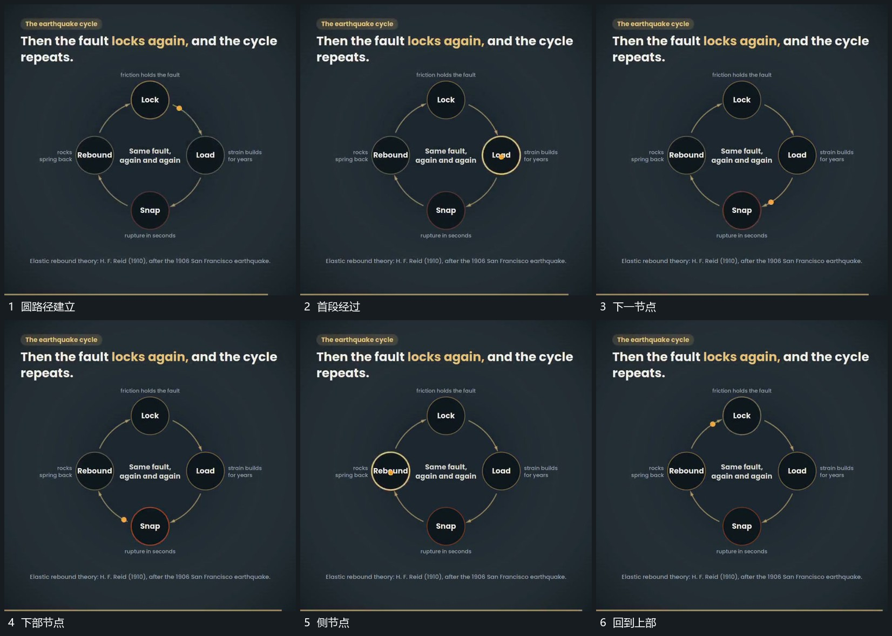

# 点沿圆形路径依次经过节点，到站节点突出后继续绕行

## 运动指令

让亮点沿圆形路径连续经过多个固定节点，到达节点时补局部边界或亮度反馈，离开后交给下一节点。节点位置保持，点继续绕行形成循环。

## 视频切片

[播放本机制的原片切片](m06.mp4)

覆盖分镜中“圆路径建立”至“回到上部”的连续过程，并保留邻近的前后衔接画面；原片中交叠发生的动作一并保留。

## 分镜过程

## 组合与调整

不必固定节点名称。反馈要跟随真实到站位置，避免全节点同时突出。
