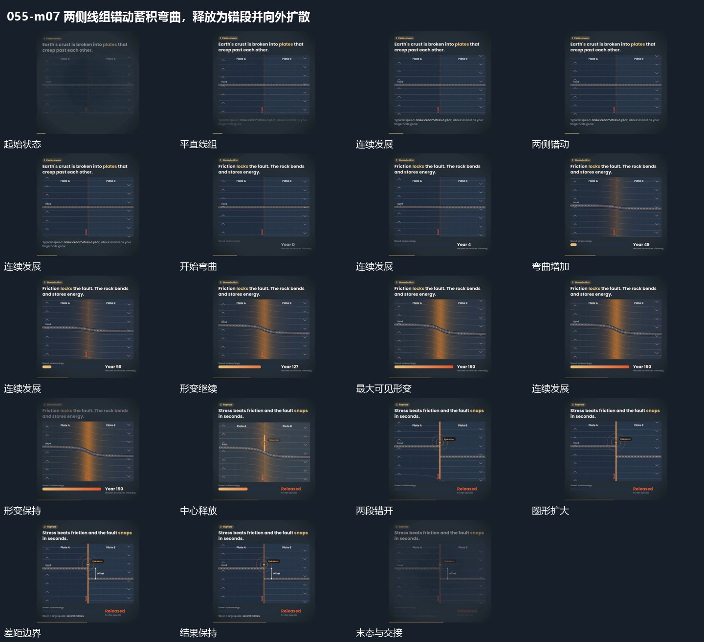

# 两侧线组错动蓄积弯曲，释放为错段并向外扩散

## 运动指令

分界两侧反向错动，中部连线持续弯曲；积累到临界后突然松开成错段，中心向外扩散并补齐新边界。

1. **分界两侧线组反向错动，中部连线逐渐弯曲**

保留中央分界，两侧线组沿相反方向缓慢错动。中部连线暂时维持连接，逐渐弯曲成跨过分界的形变，下方短条随推进延长，数值增加。

2. **弯曲组短促释放成错段，中心圈扩散后补差距边界**

在弯曲组达到稳定形变后短促释放，使两段转成错开位置。中心接入扩散圈，圈增大后退弱，再补出局部差距边界，两段位置稳定。

整段结束：两段错开，差距被标出 保留必要落稳与交接，中间已建立的参照沿用到下一步骤。

## 视频切片

[播放本机制的原片切片](m07.mp4)

保留起始准备、连续发展和完成或明确交接；首尾按本段运动范围裁切，不拼接、不变速。相连的小动作合为同一完整段落。

## 分镜过程

## 组合与调整

分界两侧反向错动，中部连线持续弯曲；积累到临界后突然松开成错段，中心向外扩散并补齐新边界。 复用时可调整元素数量、幅度和相对节奏，保留上述进入、交叠与完成关系；不直接沿用原片题材或时长。

只规定相对运动，不继承物理题材或真实受力模型。

差距边界晚于实际错开。可用简单线组替代原片物体。
