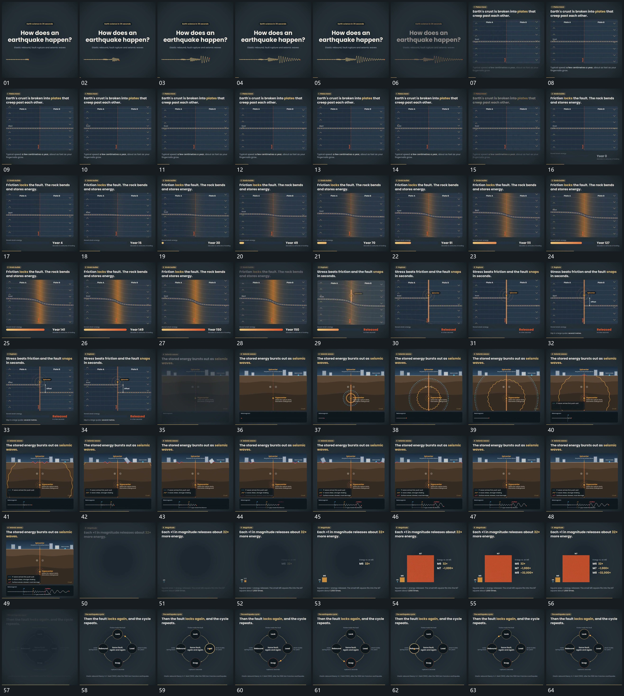

# 055｜原片运动总览

[观看完整原片](video.mp4)

## 运动总览

开头 波形从左向右延长，振幅增大后逐步收回 将一条短波形从左向右延长，振幅先增大后收回。分界两侧线组反向错动，中部连线逐渐弯曲 保留中央分界，让两侧线组沿相反方向缓慢错动；之后中部横线逐渐弯曲，下条延长，数值增加。

中段 弯曲组短促释放成错段，中心圈扩散后补差距边界 将弯曲组释放成错开的两段，中心小圈扩散，短边界补出两段差距。中心多层圆波向外扩散，经过后外围块摆动，下方波形接续 在新固定空间从中心扩出多层圆波，外围块在波经过后轻微摆动，下方小波形接续增长。小方块先建立，后续更大方块依次接入 从小方块逐次建立更大方块，已有块保持。末段 点沿圆形路径依次经过节点，到站节点突出后继续绕行 用点沿圆形路径依次经过多个节点，每到一处该节点突出，继续下一处并循环保持。

## 完整运动段落

以下按原片中的出现顺序引用。建立、内部发展及完成反馈放在同一段中；同时发生的局部动作与运镜写在同一份指令里。不同段之间可以是连续接管，也可以是直接切换，不能仅凭条目相邻认定可直接拼接。重复出现的同类运动采用一次连续代表范围，切片不以逐段无缝覆盖整片为目标。

1. [波形从左向右延长，振幅增大后逐步收回](mechanisms/m01.md)：线向右增长，局部起伏变化

2. [两侧线组错动蓄积弯曲，释放为错段并向外扩散](mechanisms/m07.md)：分界两侧反向错动，中部连线持续弯曲；积累到临界后突然松开成错段，中心向外扩散并补齐新边界。

3. [中心多层圆波向外扩散，经过后外围块摆动，下方波形接续](mechanisms/m04.md)：圆波先出，外围摆动后接

4. [小方块先建立，后续更大方块依次接入](mechanisms/m05.md)：前块保持，后块逐次扩大建立

5. [点沿圆形路径依次经过节点，到站节点突出后继续绕行](mechanisms/m06.md)：沿线移动，到站反馈接上

切片保留起始准备、必要内部停顿和完成或明确交接；首尾省略无新发展的等待，持续运动不要求人为停住。以上基于真实源帧序列和重点边界核对，不等同于全片连续声画审片。

## 完整64宫格

