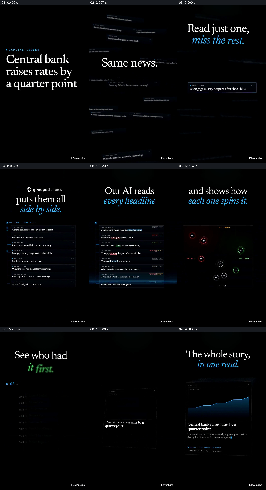

# 先看同一事件的不同标题，再归成一份可追溯阅读

- 作品：案例 051，新闻聚合产品演示（库内案例）。
- 原片范围：00:00.000–00:23.000；[完整原片](../video.mp4)｜[本卡片段](c01.mp4)。含起点、不含终点。
- 观察方式：查看整片 64 格与本卡九宫格；未独立连续原速观看或听审，快切、停顿、声音及口吻未确认。下文观看价值为作品分析，迁移未实测。

## 原画面具体怎样设计

竖屏黑底上，一组关于加息的英文标题分别占据主要空间，上方以小号蓝色字标出不同媒体名；随后这些标题缩小、分散在黑色空间中，中央出现“Same news. Different spin.”。其中一条标题被细框强调，与“Read just one, miss the rest.”同屏，其余标题仍散在周围且较暗。画面将一条看法与其他并存说法放在同一个空间里。

约 8 秒，分散标题变为按行排列的同事件列表，左侧有一条竖向蓝线与节点；上方标题说明将其并排。之后各行中不同词语出现蓝、红或绿色标记，行尾出现简短类别标签。相同的一组标题既作为阅读对象，也被画面重新组织成可比较的集合。

约 13 秒，列表交给四象限分布图：画面以左右、上下轴标出正负与戏剧化／平静，媒体以带首字母的彩色圆点分布；部分点旁出现对应标题框。接着换成纵向发布时间列表，时间与来源名沿同一条线排列，最早项被单独标记。约 18 秒后，一张报道页面接管画面，上方曲线、下方事件标题与摘要逐渐显现，页尾列出来源；该页是本段的汇合结果，之后原片开始展示其他新闻和订阅入口。

## 为什么这样设计，好在哪里

先让同一事件的不同标题分别出现，再把它们散落在一个空间并突出其中一条，观众可以理解“只看一条会遗漏其他角度”指的是哪些具体材料。列表保留每一条的标题与来源，之后才分别转为词语、立场位置和时间顺序的比较；不同观察方式都围绕同一组材料，而不是不断引入无关图形。

最后一页文章从多份材料收回一个阅读对象，并在页尾给出原文入口，形成从差异到综合的结果。以上是视觉设计分析；示例媒体、立场分类、时间和“AI 读取”均是片中演示，不能仅凭界面判定真实媒体发表时间、分类准确性或文章事实已核实。

## 可直接使用的创意指令

当同一事件确有多份相互独立且可引用的报道、观点或材料时，先呈现几条能够看出角度差异的原始内容；保留来源身份，再让这些材料在同一空间聚成可阅读列表。依据实际材料选择少量确有意义的比较维度，例如措辞差异、观点关系或公开时间；从同一列表切换到相应图形时，让图中每个标记仍可对应回具体来源。

比较完成后，将已核实的共同事实与必要差异整理成一个可阅读的结果，保留原始出处入口。颜色、画幅、排列、标记和比较维度均可调整；不可丢失的是同一事件的真实来源、比较口径及回到原文的路径。材料不足以支持立场判断或时间先后时，应舍去相应图表，不把演示坐标当作事实。
