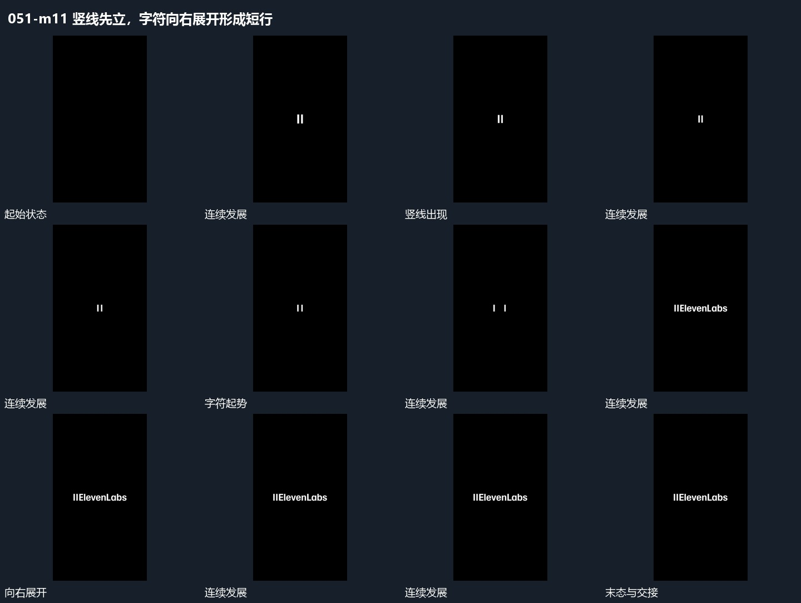

# 竖线先立，字符向右展开形成短行

## 运动指令

在空底中先建立竖线，再从竖线旁展开字符，使短行向右逐渐变完整。字符落位后竖线与短行共同保持到末尾，不继续加入新的层级。

## 视频切片

[播放本机制的原片切片](m11.mp4)

保留起始准备、连续发展和完成或明确交接；首尾按本段运动范围裁切，不拼接、不变速。尾部只保留理解结果所需的展示。

## 分镜过程

## 组合与调整

适合从前一段退出后的简短收尾起步。可改展开方向，仍需给字符一个明确的起始边界；不要求沿用原片署名内容。
