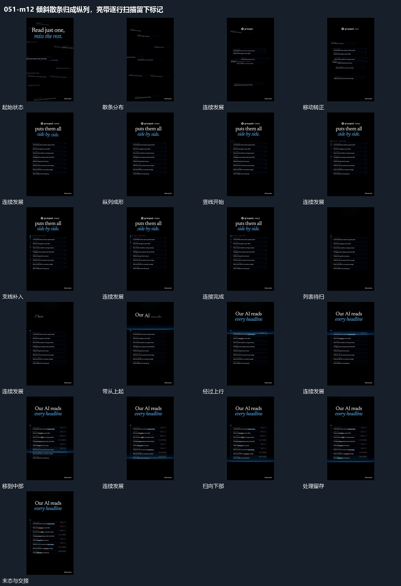

# 倾斜散条归成纵列，亮带逐行扫描留下标记

## 运动指令

散条先转正归队并连成纵列，形成稳定列表；亮带沿列表向下经过，各行新增标记留在原位置。

1. **倾斜散条转正归队，再沿侧边连成纵列**

让分散且倾斜的条片各自移动到纵列位置，边移动边转正，使左右边逐步对齐；未归队的外围条片退去。排列基本成立后，从侧边建立竖线，再按行延长短支线接到条片，已连好的行保持。

2. **亮带逐行下扫，经过处保留新增标记**

从纵列上方开始，让一条较亮的横带向下移动。每经过一行，就在该行补入局部短词和末端标记；横带继续走，处理后的行仍保持，未到达的行等待。扫到尾部后移除扫描强调，留下完整结果列。

整段结束：亮带扫完，多行保留各自新增的短词和末端标记。 保留必要落稳与交接，中间已建立的参照沿用到下一步骤。

## 视频切片

[播放本机制的原片切片](m12.mp4)

保留起始准备、连续发展和完成或明确交接；首尾按本段运动范围裁切，不拼接、不变速。相连的小动作合为同一完整段落。

## 分镜过程

## 组合与调整

散条先转正归队并连成纵列，形成稳定列表；亮带沿列表向下经过，各行新增标记留在原位置。 复用时可调整元素数量、幅度和相对节奏，保留上述进入、交叠与完成关系；不直接沿用原片题材或时长。

可改变行数和间隔，但保留先归队后连接的关系。若直接接扫描，先给扫描留出清楚的首行位置，不要连线还未建立就跳过整列。

可改为从下往上，需保持未处理、正在处理、已处理三种阶段。下一机制可让保留的行端标记散出，不能每扫一行就重置前面结果。
