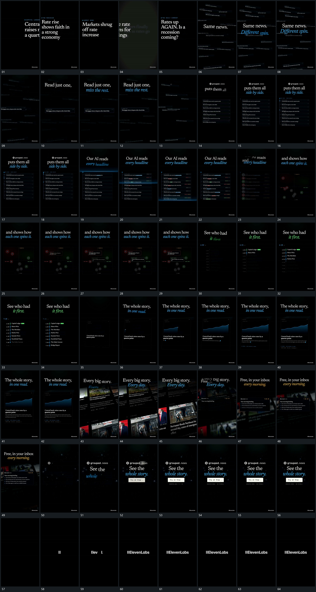

# 051｜原片运动总览

[观看完整原片](video.mp4)

## 运动总览

开头 大字横向轮换，退去后散条与中央文字分层建立 让大字横向轮换，转入后层散条和中央清楚字组。从流动散条中突出一条，其余退淡 从散条集合中突出一条，随后 倾斜散条转正归队，再沿侧边连成纵列 将散条转正归队，排成纵列并补入侧线连接。

纵列建立后，亮带逐行下扫，经过处保留新增标记 逐行扫描并留下结果。接 行端圆点脱离旧列表，散开后落到新坐标 留下行端圆点，退去旧框与文字，让节点散开、落到新线框里；节点外圈扩散，旁侧浮卡按点接力出现 逐个提示节点并展开浮卡。之后这组退出，亮点沿纵线下行，各行依次显清并更新计数 用新的竖向路径依次激活行文和计数。

下一矩形倾斜入位，折线端点向右推进，填充与下方文字接续增长 在内部增长折线、填充及下方文字。再切到 多排图块横向流动，前景小框接管而底层继续 的多排图块流动，后层退虚但继续运动，前方小框与列表接管观看重点。

后段 中心组由上至下逐层建立，最后保持整体 将上标、主副行与长条逐层建立，保持后退成空底。尾部 竖线先立，字符向右展开形成短行 先立竖线再向右展开短行，完成整片收势。这里仅记录图块与文字的运动，不由原片题材推断外部视频素材。

## 完整运动段落

以下按原片中的出现顺序引用。建立、内部发展及完成反馈放在同一段中；同时发生的局部动作与运镜写在同一份指令里。不同段之间可以是连续接管，也可以是直接切换，不能仅凭条目相邻认定可直接拼接。重复出现的同类运动采用一次连续代表范围，切片不以逐段无缝覆盖整片为目标。

1. [大字横向轮换，退去后散条与中央文字分层建立](mechanisms/m01.md)：大字轮换退出后分层建立，中央保持清楚，外围仍移动。

2. [从流动散条中突出一条，其余退淡](mechanisms/m02.md)：选中项从原集合中获得边界和位置重点，标题留场。

3. [倾斜散条归成纵列，亮带逐行扫描留下标记](mechanisms/m12.md)：散条先转正归队并连成纵列，形成稳定列表；亮带沿列表向下经过，各行新增标记留在原位置。

4. [行端点脱离列表散开落位，外圈扩散并接入旁卡](mechanisms/m13.md)：原列表行端点脱离并散开，重新落到分散位置；各点外圈扩散，旁侧浮卡跟随对应点接力出现。

5. [亮点沿纵线下行，各行依次显清并更新计数](mechanisms/m07.md)：纵向推进负责顺序，文字显清与计数响应同一进展。

6. [折线端点向右推进，填充与下方文字接续增长](mechanisms/m08.md)：折线端点带出旧路径，填充跟随；文字独立累积而不擦掉图形。

7. [多排图块横向流动，前景小框接管而底层继续](mechanisms/m09.md)：集合运动不断，清楚的前景层随后建立，形成不同运动层级。

8. [中心组由上至下逐层建立，最后保持整体](mechanisms/m10.md)：各层按纵向次序进入，已建立层留场，不随下一层重新入场。

9. [竖线先立，字符向右展开形成短行](mechanisms/m11.md)：竖线先提供起始锚点，字符随后向右建立。

切片保留起始准备、必要内部停顿和完成或明确交接；首尾省略无新发展的等待，持续运动不要求人为停住。以上基于真实源帧序列和重点边界核对，不等同于全片连续声画审片。

## 完整64宫格

