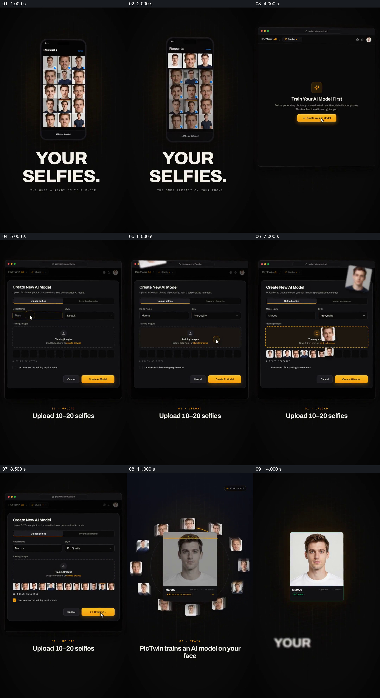

# 从手机里的一组自拍，聚到一张处于就绪状态的人物卡

- 作品：案例 007，自拍与人物图像产品展示（库内案例）。
- 原片范围：0.000–15.000 秒；[完整原片](../video.mp4)｜[本卡片段](c01.mp4)。范围含起点、不含终点。
- 观察方式与未确认范围：查看整片 64 帧总览和本卡九宫格；未独立完成原速连续观看。经媒体信息检查此原片无音轨，因此无声音可听审；抽帧间的动作、停顿及速度仍待复核。以下价值是基于画面的分析，迁移效果尚未实测。

## 原画面具体怎样设计

开头黑底中央有一部竖直手机，屏幕内按网格排列同一名男子的多张肖像，蓝色选中标记逐渐增加；手机下方的大字写“YOUR SELFIES”，小字说明照片已在手机中。随后相同类型的头像以小卡形式分布在手机前方，画面接入深色网页。

约 4 秒，网页中央显示“Train Your AI Model First”和创建按钮；接着打开创建界面，顶部有姓名、样式，中央是虚线上传区，下方原本空置的格子逐渐被不同肖像填满。界面上的选择数到达 12，按钮进入创建状态。约 10 秒，网页让位于居中的人物卡：大肖像在中间，小头像排列在四周，并出现橙色线、进度及“training in progress”字样。后续小头像退出或退弱，中央卡片显示绿色“ready”，下方文字把结果称为识别这张脸的个人模型。

## 为什么这样设计，好在哪里

最初手机中的多张自拍已经显示主体相似但角度和表情不同，随后上传界面把这些不同图像逐个收集到一个可见位置。环绕中央肖像的小图则把“多份输入与一个中心对象”的关系从表单转成容易辨认的空间关系；最后只留下中心卡及就绪状态，让观众知道前面展示有了一个结果。

如果直接切到一个人物卡，会省略多份输入怎样与它关联；如果只保留上传列表，又少了面向下一步可使用的结果。这里的训练和识别均为片中宣称，视觉示意不证明实际算法或成功率；静帧不能确认头像路径、扫描速度和真实训练时长。

## 可直接使用的创意指令

当多份素材共同对应一个归纳结果时，先选择能看出共同主体与各自差异的输入，例如同一对象的不同视角或多份同主题记录。展示输入如何被收集到同一容器，再让这些输入围绕或共同指向一个可辨认的中心结果；需要表现处理状态时，以清楚标注的阶段状态承接，最后留下能够被后续场面继续引用的结果。

手机、头像、圆环、扫描线和颜色都可替换；关键是输入之间的共同点、从集合到单个结果的关系及结果状态。真实素材与处理结果须具备相应授权和依据，模拟训练画面应明确为演示。
