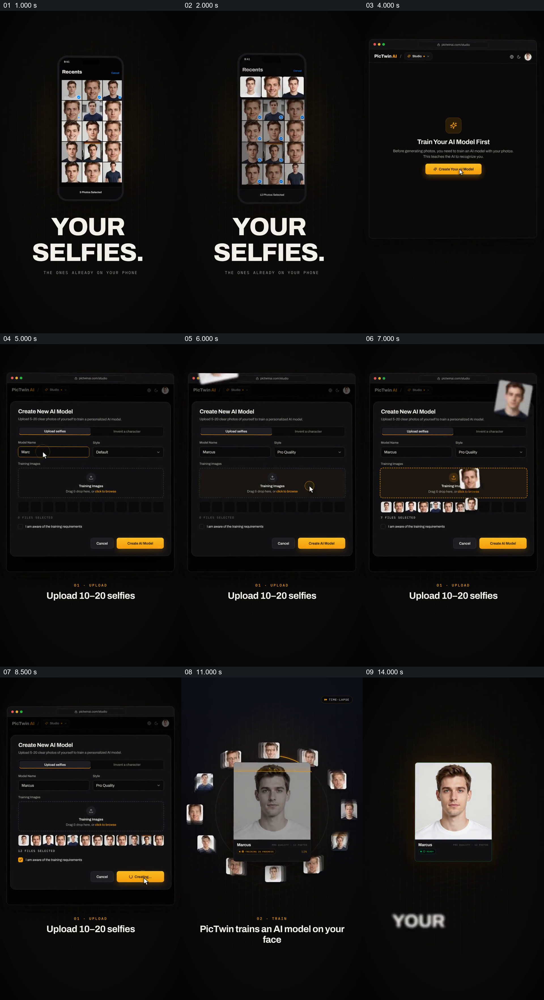

# 从手机自拍到中心人物卡，形象化展示建立个人模型

- 作品：案例 007《竖框、图块与指示符的分批接力》（索引名称）。
- 原片范围：00:00.000–00:15.000，含起点、不含终点；[完整原片](../video.mp4)｜[本卡完整片段](c01.mp4)。
- 观察方式：按整片 64 宫格和约每秒一个原片帧观察全片，并选取下方九个源帧；未连续原速观看。原片没有音轨。

## 原画面具体怎样设计

手机相册中是一组相似男性自拍，选中数量增加，旁边写 YOUR SELFIES。画面切到创建模型的网页式界面，单张自拍先后飞入上传区，底部缩略图逐项增加；随后中央是一张人物肖像卡，周围多张自拍排成环，脸部出现点线和进度，最后外围照片退去，只留下带就绪状态的彩色人物卡。下方文字把过程称为用自拍训练人物模型。

## 为什么这样设计，好在哪里

先给观众看具体输入，再让这些相片围绕一个中心肖像，多个来源与单一结果之间的关系有可见形态。环绕、点线与进度是训练过程的示意，不能证明真实模型如何学习或输出的人物相似度；界面上方与画面字幕给出的上传数量范围也不一致，不能据此确定实际要求。 这是基于画面的作品分析，不代表作者自述或已测量的观众反应。

## 可直接使用的创意指令

当需要解释多份输入共同建立一个主体时，先展示经授权的具体输入及实际要求，让各项材料进入同一接收区域；再以一个可辨认的中心主体和周围输入的关系概括处理，完成后保留明确结果状态。动态点线或进度可用于说明，但应标注其示意性质，不能冒充真实计算过程；素材数量、身份授权和功能状态以实际产品为准。
