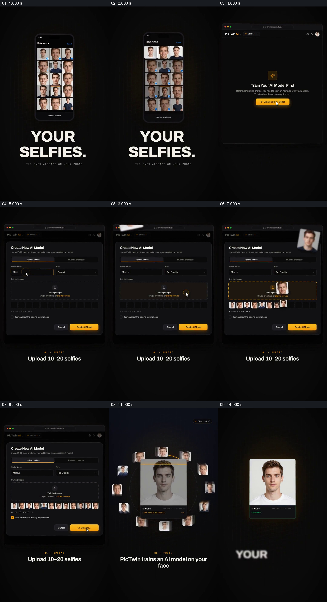

# 从手机里的一组自拍，聚到一张处于就绪状态的人物卡

- 作品：案例 007，自拍与人物图像产品展示（库内案例）。
- 原片范围：0.000–15.000 秒；[完整原片](../video.mp4)｜[本卡片段](c01.mp4)。范围含起点、不含终点。
- 观察方式与未确认范围：查看整片 64 帧总览和本卡九宫格；未独立完成原速连续观看。经媒体信息检查此原片无音轨，因此无声音可听审；抽帧间的动作、停顿及速度仍待复核。以下价值是基于画面的分析，迁移效果尚未实测。

## 原画面具体怎样设计

开头黑底中央有一部竖直手机，屏幕内按网格排列同一名男子的多张肖像，蓝色选中标记逐渐增加；手机下方的大字写“YOUR SELFIES”，小字说明照片已在手机中。随后相同类型的头像以小卡形式分布在手机前方，画面接入深色网页。

约 4 秒，网页中央显示“Train Your AI Model First”和创建按钮；接着打开创建界面，顶部有姓名、样式，中央是虚线上传区，下方原本空置的格子逐渐被不同肖像填满。界面上的选择数到达 12，按钮进入创建状态。约 10 秒，网页让位于居中的人物卡：大肖像在中间，小头像排列在四周，并出现橙色线、进度及“training in progress”字样。后续小头像退出或退弱，中央卡片显示绿色“ready”，下方文字把结果称为识别这张脸的个人模型。

## 为什么这样设计，好在哪里

最初手机中的多张自拍已经显示主体相似但角度和表情不同，随后上传界面把这些不同图像逐个收集到一个可见位置。环绕中央肖像的小图则把“多份输入与一个中心对象”的关系从表单转成容易辨认的空间关系；最后只留下中心卡及就绪状态，让观众知道前面展示有了一个结果。

如果直接切到一个人物卡，会省略多份输入怎样与它关联；如果只保留上传列表，又少了面向下一步可使用的结果。这里的训练和识别均为片中宣称，视觉示意不证明实际算法或成功率；静帧不能确认头像路径、扫描速度和真实训练时长。

## 完整照排指令

以[完整原片](../video.mp4)的 0–15 秒为准。画幅 720×1280，源帧率 30/1。以下拍点为抽帧定位，位置按画幅百分比取近似值。

### 用料

- 【自拍组】为同一位授权人物的多角度肖像，覆盖正面、侧向、不同距离等可辨变化。手机目录、飞入缩略图、上传列与外围肖像环复用同一组文件。【就绪肖像】为同一人或同一项目的最终预览，居中、浅底，无大幅裁切跳变。真实产品须附操作记录并具备展示肖像的许可。
- 【开场大字】【引导标题】【创建按钮】【设置字段】【上传句】【训练句】【就绪状态】【片段收束句】分别与实际流程相符。输入数量如需写入【上传句】，依据真实规格。

### 按源时刻摆放

1. **0.000–约 3.000 秒。** 竖幅近黑背景带暖灰晕光。窄手机在中上，黑细外壳里用三列密排【自拍组】，全是同一人。下方两行白粗大【开场大字】由虚到实，底边留小弱字。近 2.5 秒照片从手机格位抽出成大小不一的竖图，跨同一路径向前，手机与下字退暗。静照可做空间位移。
2. **约 3.000–6.000 秒。** 切深色网页，引导页中部有【引导标题】与暖黄【创建按钮】，再进入占幅大的深色表单。顶栏和字段细白线低亮，表单中上部列【设置字段】，右下黄钮保留，底部画外独立居中白色【上传句】。字段依次被选，强调用局部暖黄小线。
3. **约 6.000–9.500 秒。** 【自拍组】中的独立相片从两侧或斜上飞入，先可认出整张脸，再收小落到表单下部的一排上传缩略图。同组相片已落位后仍留着，新图继续填后方，不让进入过程顶掉旧图。约 8.5 秒后列满，提示和按钮仍在。源素材是静照，禁止用多个不同身份拼成一套。
4. **约 9.500–13.500 秒。** 表单整体退出，中轴建立浅底【就绪肖像】竖卡，卡底留暗小状态区。先灰后暖，外围用同一【自拍组】小图铺出椭圆环，从稀到密，环卡以可辨前后关系绕中心。下方居中两行白色小【训练句】，保持中心卡静止。环图可用静照运镜，转一段连续路径直至集中，勿让关键图片跳回屏外重新进入。
5. **约 13.500–15.000 秒。** 暖金强调短暂包住中心卡，外环消失而【就绪肖像】仍在原位。其下小绿或浅色【就绪状态】稳定。下方【片段收束句】由白粗字和暖黄强调行渐次组成，到 15.000 秒截出。

### 局部采用

有合法使用的同源自拍和完整上传过程，可用约 3–9.500 秒。已有照片与真实人物卡，可用约 9.500–15 秒作为集合收拢拍。

### 验证状态

已核对每秒两帧原片画序并读回，检查目录照片到上传列、中心卡与照片环的同屏、环退而人物卡留。精确切帧、原速听看与换料待核。
