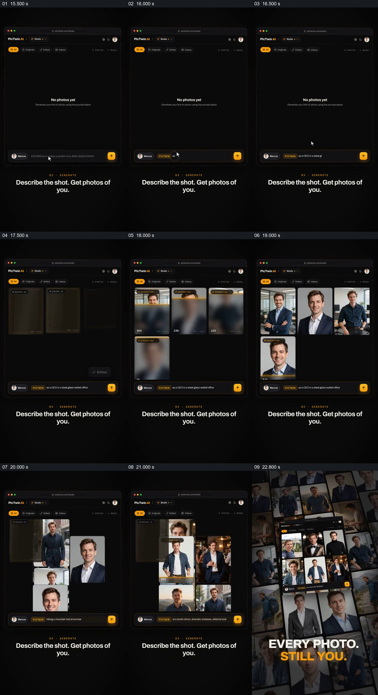

# 让不同描述产生多张人物结果，最后扩展成整面肖像墙

- 作品：案例 007，自拍与人物图像产品展示（库内案例）。
- 原片范围：15.000–23.500 秒；[完整原片](../video.mp4)｜[本卡片段](c02.mp4)。范围含起点、不含终点。
- 观察方式与未确认范围：查看整片 64 帧总览和本卡九宫格；未独立完成原速连续观看。经媒体信息检查此原片无音轨，因此无声音可听审；抽帧间的动作、停顿及速度仍待复核。以下价值是基于画面的分析，迁移效果尚未实测。

## 原画面具体怎样设计

约 15 秒，画面回到深色网页，中央写“No photos yet”，底部输入条左侧有人物小头像与 Marcus 名称，中间是输入描述，右侧是橙色箭头。随后出现多个空的排队卡，卡内标有生成状态；接下来的源帧中，卡面从模糊状态露出男子的不同办公室肖像，部分卡下方显示百分比和横线。

之后输入文字与照片内容发生变化：片中展示了办公、户外或棚拍等不同环境和服装，结果逐渐在页面中并列。约 22 秒，页面缩为前景小窗口，背景扩成由多张人物照片组成的倾斜墙面，前景页面仍能辨认；大字“EVERY PHOTO. STILL YOU.”覆盖在下方，形成多种结果属于同一主体的片中结论。

## 为什么这样设计，好在哪里

空页面使输入之前的状态清楚，输入条里的小头像持续提示本段围绕谁展开；多个独立卡片保留自己的状态，允许观众先看个别结果，再看到数量积累。最后由网页集合扩展为背景照片墙，既强化多种环境与服装的差异，也让反复出现的相似人物成为视觉共同点。

这一效果依赖“条件改变而主体仍可辨认”，若每张照片换成完全无关的人，最后的结论就失去画面依据。人物相似、生成进度及训练能力均是作品展示；未核实是否由该工具实际生成，也不能根据抽帧证明瞬时运动速度。

## 可直接使用的创意指令

适合展示一个共同主体在多种条件下的不同结果。先以明确的主体标识和可理解的条件输入建立起点；让多个输出各自保有独立边界及可辨认的状态，保留一个以上中途结果，避免直接把空白变成成品墙。随后改变确有差异的条件，展示与之对应的结果，最后将已出现的结果并置或扩展为集合。

场景、人数、描述方式、容器和画幅可以调整；需保留相同主体或共同参照、条件差异及可比较的结果。不要把未经核实的生成或一致性当成真实产品能力；结果不具备足够共同点时应重新选素材。
