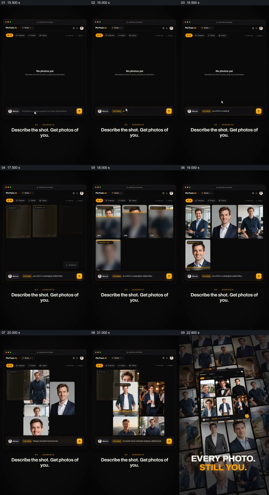

# 让不同描述产生多张人物结果，最后扩展成整面肖像墙

- 作品：案例 007，自拍与人物图像产品展示（库内案例）。
- 原片范围：15.000–23.500 秒；[完整原片](../video.mp4)｜[本卡片段](c02.mp4)。范围含起点、不含终点。
- 观察方式与未确认范围：查看整片 64 帧总览和本卡九宫格；未独立完成原速连续观看。经媒体信息检查此原片无音轨，因此无声音可听审；抽帧间的动作、停顿及速度仍待复核。以下价值是基于画面的分析，迁移效果尚未实测。

## 原画面具体怎样设计

约 15 秒，画面回到深色网页，中央写“No photos yet”，底部输入条左侧有人物小头像与 Marcus 名称，中间是输入描述，右侧是橙色箭头。随后出现多个空的排队卡，卡内标有生成状态；接下来的源帧中，卡面从模糊状态露出男子的不同办公室肖像，部分卡下方显示百分比和横线。

之后输入文字与照片内容发生变化：片中展示了办公、户外或棚拍等不同环境和服装，结果逐渐在页面中并列。约 22 秒，页面缩为前景小窗口，背景扩成由多张人物照片组成的倾斜墙面，前景页面仍能辨认；大字“EVERY PHOTO. STILL YOU.”覆盖在下方，形成多种结果属于同一主体的片中结论。

## 为什么这样设计，好在哪里

空页面使输入之前的状态清楚，输入条里的小头像持续提示本段围绕谁展开；多个独立卡片保留自己的状态，允许观众先看个别结果，再看到数量积累。最后由网页集合扩展为背景照片墙，既强化多种环境与服装的差异，也让反复出现的相似人物成为视觉共同点。

这一效果依赖“条件改变而主体仍可辨认”，若每张照片换成完全无关的人，最后的结论就失去画面依据。人物相似、生成进度及训练能力均是作品展示；未核实是否由该工具实际生成，也不能根据抽帧证明瞬时运动速度。

## 完整照排指令

以[完整原片](../video.mp4)的 15–23.5 秒为准。画幅 720×1280，源帧率 30/1。以下拍点为抽帧定位，位置按画幅百分比取近似值。

### 用料

- 【人物身份】沿用前卡已就绪的授权主体。备【描述组】两至三条，分别指定服装、场景或景别，给每条准备有对应来源的【结果肖像组】。各图须是同一人的可辨形象，靠衣着、位置与姿态拉开轮廓。另备【编辑前图】【编辑后图】【邻段动图】，编辑前后取同一图的实际改动，保留共用坐标。
- 【空结果提示】【操作短句】【墙面首句】【墙面次句】【邻段编辑句】【邻段动态句】用短文。真实生成演示留输入、输出与授权记录；只作预设表演时标明演示。

### 按源时刻摆放

1. **15.000–约 17.500 秒。** 竖幅近黑。中央上部摆宽近满幅的暗工具窗，顶部细栏和小黄状态点，窗内中间用小灰白【空结果提示】。下沿输入框低亮，左边小头像回指【人物身份】，右边暖黄方钮。约 15.5 秒下方独立居中白色【操作短句】，随后在框内依次打入【描述组】第一条。
2. **约 17.500–21.500 秒。** 空区进入三列结果，先有灰黑模糊的竖卡和暖黄细缘，再逐个变清，读取【结果肖像组】。首批上排与左下部分先完成，随后输入变更、卡组移位增补下一批，保留窗底输入条。结果建立时，已清楚的相邻卡继续作为同一人物的参照，新卡先占自己的格位再变清。小窗为静态照片，可用模糊到清楚或移位，无需用视频循环模拟生成。
3. **约 21.500–23.000 秒。** 工作窗缩进中上，前景仍能辨其按钮和结果。背景放大同组照片，形成斜向密铺的人像墙，外围压暗，避免与中窗争亮。下方靠中两行粗大【墙面首句】【墙面次句】，第一行白，第二行暖黄。内外只用同一【结果肖像组】或其同一输入批次的照片，保持同脸而造型变化。照片墙与中窗一起留到切出。
4. **约 23.000–23.500 秒。** 切回深色工具单图，中央浅底肖像占大幅，开始出现【编辑前图】和底部控件，【邻段编辑句】在下方。若随后接【编辑后图】或【邻段动图】，保持同一身份；本卡以 23.500 秒索引边界切出，边界附近具体进入了哪个邻段状态待逐帧确认。

### 局部采用

仅有配对描述和结果可用约 15–21.500 秒。只有可信的一组输出可用约 21.500–23 秒的人像墙，依据新片上下文交代它们的关系。

### 验证状态

已对照原片每秒两帧画序并读回正文。核对空界面到填格、卡片变清与分批替换、中心工具窗和外围墙同屏。快切精确点、原速听看与换料试摆待核。
