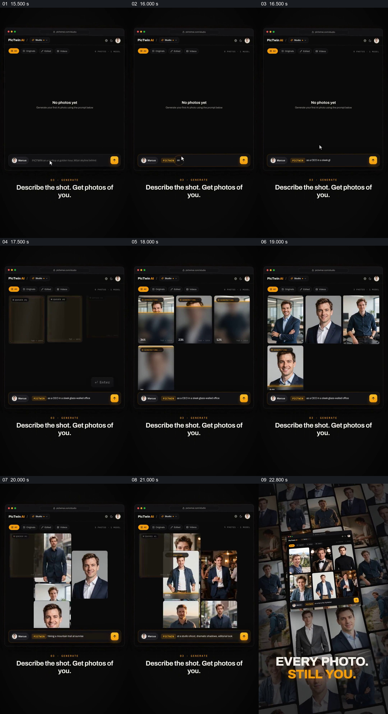

# 输入不同描述，让同一主体出现在多种结果里

- 作品：案例 007《竖框、图块与指示符的分批接力》（索引名称）。
- 原片范围：00:15.000–00:23.500，含起点、不含终点；[完整原片](../video.mp4)｜[本卡完整片段](c02.mp4)。
- 观察方式：按整片 64 宫格和约每秒一个原片帧观察全片，并选取下方九个源帧；未连续原速观看。原片没有音轨。

## 原画面具体怎样设计

空白结果页下方出现描述输入，随后数张人物照片从模糊和进度状态逐步显示。输入内容变化时，界面继续补入不同场景、衣着和构图的人物照片；画面再拉成大量照片组成的背景墙，中央保留结果页面，文字写“EVERY PHOTO. STILL YOU.”。

## 为什么这样设计，好在哪里

输入、逐项出现的候选和最终结果墙依次给出从描述到多种画面的观看过程；相近的脸部特征使观众能把不同场景读作同一个主体的变化。片中展示并不能证明这些图片由该系统即时生成，或证明每张图的身份准确。 这是基于画面的作品分析，不代表作者自述或已测量的观众反应。

## 可直接使用的创意指令

当需要展示一个主体在多种候选中的变化时，先明确用户输入和经授权的主体，再逐项展示与输入相关的真实结果或明确标注的示意。保持足够的识别线索，同时让场景、服饰或构图的差别清楚可见；最后可把已展示的结果集中成组，供观众比较。实际生成能力和身份一致性须以真实输出验证，不能把示意图片当成现场照片。
