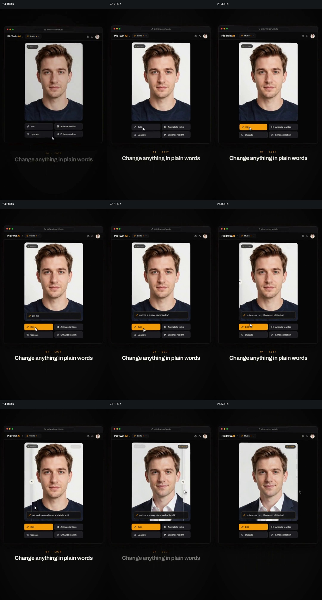

# 保持头像取景，用同一画面交代衣服修改前后

- 作品：案例 007，自拍与人物图像产品展示（库内案例）。
- 原片范围：23.100–24.533 秒；[完整原片](../video.mp4)｜[本卡片段](c03-20261111.mp4)。含起点、不含终点。
- 观察方式与未确认范围：查看全片 64 帧总览，本段另按 0.2 秒抽查 23.3–25.5 秒源帧并制作本卡九宫格。未独立完成连续原速观看；原片无音轨。细微动作、速度与迁移效果仍待复核。

## 原画面具体怎样设计

约 23.1 秒，前一段照片墙交给一张深色网页：中央是白底、深色圆领的男子正面肖像，图下方有 Edit、Animate to video 等控件，旁边的阶段字写“04 · EDIT”。源帧显示输入框里逐渐出现把衣服改成海军蓝外套和白衬衫的英文要求，肖像角上标有“BEFORE”。

约 24 秒，肖像内出现竖直分界；其左侧仍是圆领服装，右侧显出西装外套和白衬衫，并出现“AFTER”标记。到 24.5 秒，修改后的版本在同一白底窗口中成为主要画面；肖像、输入框及下方编辑按钮之间的相对位置保留，下一场才更换为旅行照片。

## 为什么这样设计，好在哪里

前后两版使用相近的脸部大小、位置和白底，变化集中在衣物，观众无需在两张不同镜头之间寻找差别。文字输入放在同一肖像下，建立“希望改变什么”和“画面实际改变哪里”的对应；分界线让两个状态在短暂的同一构图里相遇，再把结果留在窗口中。

若用两个取景差异很大的头像快速交替，服装可能仍不同，但观众需要额外判断人像位置变化。这里的编辑过程与前后图均为原片演示，不证明实际工具能精确完成该修改；抽帧也不证明分界线的连续速度和手势操作。

## 可直接使用的创意指令

适合展示同一对象的局部前后变化。先准备身份、视角和背景足够一致的两种真实状态，把变化诉求放在观众能同时读到的位置；以清楚的局部分界或其他可比较方式让前后状态在同一空间出现，保留不变部分作为参照，并在比较之后留下完整结果供阅读。

对象、改变的属性、文字位置、分界形状和色彩可重新设计；需要保留同一对象的可辨认性和具体改变区域。不要以不同人物或不同角度制造未经证实的处理效果；若变化需要长时间观察，应延长结果停留。
