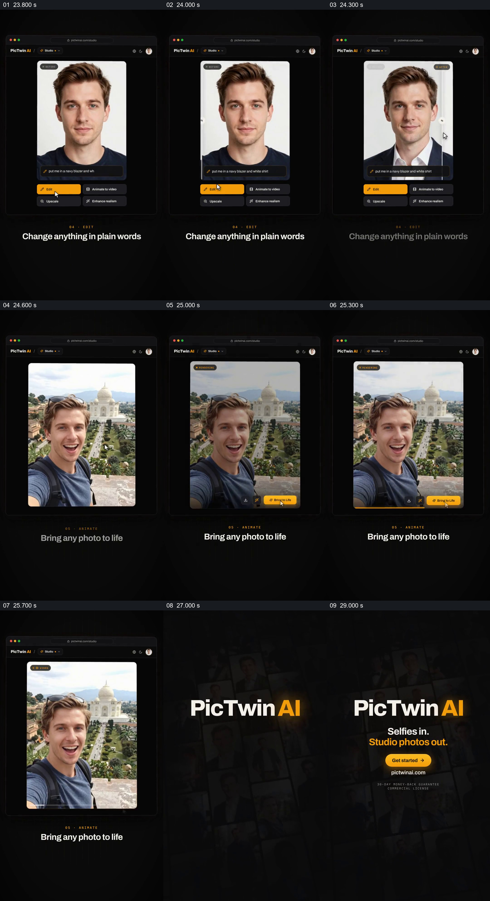

# 从文字修改前后对照接到照片动态化与入口

- 作品：案例 007《竖框、图块与指示符的分批接力》（索引名称）。
- 原片范围：00:23.500–00:30.000，含起点、不含终点；[完整原片](../video.mp4)｜[本卡完整片段](c03.mp4)。
- 观察方式：按整片 64 宫格和约每秒一个原片帧观察全片，并选取下方九个源帧；未连续原速观看。原片没有音轨。

## 原画面具体怎样设计

网页式界面中先有男性正面肖像，输入栏写出更换西装的要求；一条竖向分界将原先的深色上衣与修改后的西装白衬衫并置。随后切到人物在景点前的照片和“Bring to Life”按钮，界面显示处理状态；结尾出现 PicTwin AI 标识、自拍输入与影棚照片输出的短句和开始入口。

## 为什么这样设计，好在哪里

前后照片在同一位置对应，衣着变化容易定位，且人物脸部仍是比较参照；第二张照片把下一步动态化的对象展示出来，结尾再用简短输入输出关系收束。静帧无法证明动态化的视频质量、处理真实发生或品牌入口目前可用。 这是基于画面的作品分析，不代表作者自述或已测量的观众反应。

## 可直接使用的创意指令

当需要说明图片的后续修改与动态化时，先选经授权的原图和真实处理结果，以相同尺度对齐可比区域，标明修改前后及实际指令；再展示另一项操作时保持输入、处理状态和可验证结果的关系。若没有真实动态结果，应标为示意，不从按钮或单帧推断视频已经生成；入口和使用条件以当前产品为准。
