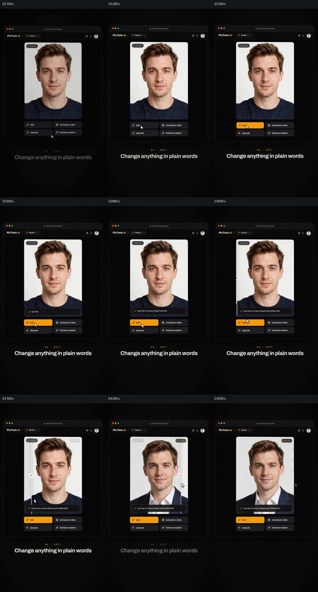

# 保持头像取景，用同一画面交代衣服修改前后

- 作品：案例 007，自拍与人物图像产品展示（库内案例）。
- 原片范围：23.100–24.533 秒；[完整原片](../video.mp4)｜[本卡片段](c03-20261111.mp4)。含起点、不含终点。
- 观察方式与未确认范围：查看全片 64 帧总览，本段另按 0.2 秒抽查 23.3–25.5 秒源帧并制作本卡九宫格。未独立完成连续原速观看；原片无音轨。细微动作、速度与迁移效果仍待复核。

## 原画面具体怎样设计

约 23.1 秒，前一段照片墙交给一张深色网页：中央是白底、深色圆领的男子正面肖像，图下方有 Edit、Animate to video 等控件，旁边的阶段字写“04 · EDIT”。源帧显示输入框里逐渐出现把衣服改成海军蓝外套和白衬衫的英文要求，肖像角上标有“BEFORE”。

约 24 秒，肖像内出现竖直分界；其左侧仍是圆领服装，右侧显出西装外套和白衬衫，并出现“AFTER”标记。到 24.5 秒，修改后的版本在同一白底窗口中成为主要画面；肖像、输入框及下方编辑按钮之间的相对位置保留，下一场才更换为旅行照片。

## 为什么这样设计，好在哪里

前后两版使用相近的脸部大小、位置和白底，变化集中在衣物，观众无需在两张不同镜头之间寻找差别。文字输入放在同一肖像下，建立“希望改变什么”和“画面实际改变哪里”的对应；分界线让两个状态在短暂的同一构图里相遇，再把结果留在窗口中。

若用两个取景差异很大的头像快速交替，服装可能仍不同，但观众需要额外判断人像位置变化。这里的编辑过程与前后图均为原片演示，不证明实际工具能精确完成该修改；抽帧也不证明分界线的连续速度和手势操作。

## 完整照排指令

以[完整原片](../video.mp4)的 23.1–24.533 秒为准。画幅 720×1280，源帧率 30/1。以下拍点为抽帧定位，位置按画幅百分比取近似值。

### 用料

【原版头像】【改版头像】来自同一张正面肖像的前后版本，锁定发际线、眼睛高度、头肩比例与浅底，只修改指定衣服。备【修改命令】【前后标签】【操作强调】【说明句】，命令须对应肉眼可检的衣服变化。备下一段可用的【邻段照片】【邻段说明】。实际成果留操作记录和原始前后图。

### 按源时刻摆放

1. **23.100–约 23.600 秒。** 竖画幅近黑底，暗色工作窗从上缘至中下，内中央大浅色圆角【原版头像】，面部居中。左上留小深胶囊【前后标签】。头像下保留暗输入区和暖黄【操作强调】；窗外下方独立居中放一行小白【说明句】。
2. **约 23.600–24.200 秒。** 设置区填入短【修改命令】，位置留在头像下。用同一窗口切进【改版头像】，在原位分割显示原前后版本。竖向分界沿脸和躯干同一画布推移，背面与头部位置对齐，使服装变化最先被看见。前后标签置靠两侧上缘，修改确认仍由底部暖黄块承担。头像允许静帧，分割时不旋转、换构图或各自运镜。
3. **约 24.200–24.533 秒。** 比较头像让位给户外彩色【邻段照片】，下方淡换【邻段说明】，按 24.533 秒切出。独立采用改衣效果时在户外照出现前结束。

### 局部采用

只有配准后的前后图时，可独立用约 23.600–24.200 秒的分界对照，并按字量延长读留。单一改后图无法承担比较。

### 验证状态

已查看本卡原片画序及索引分镜时刻后写入并读回。重点复核单图位置、衣服改变后的对位和户外照切出。分界出现的精确帧、原速听看、换料试摆待核。
