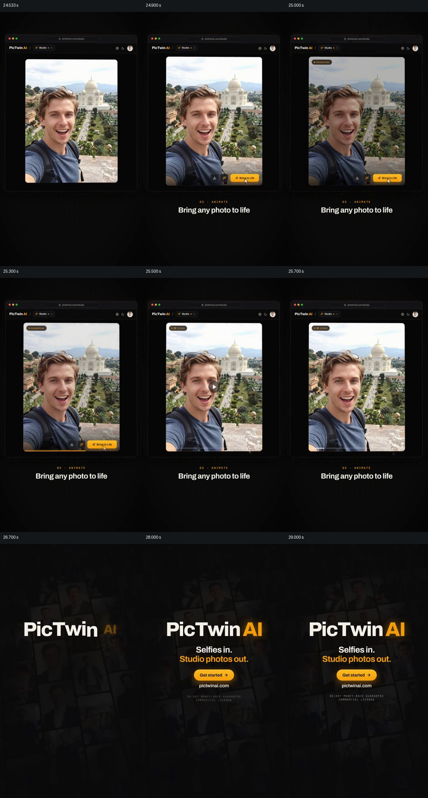

# 让另一张照片经过处理状态，接入产品入口

- 作品：案例 007，自拍与人物图像产品展示（库内案例）。
- 原片范围：24.533–30.000 秒；[完整原片](../video.mp4)｜[本卡片段](c04-20261111.mp4)。含起点、不含终点。
- 观察方式与未确认范围：查看全片 64 帧总览，本段另按 0.2 秒抽查 23.3–25.5 秒源帧并制作本卡九宫格。未独立完成连续原速观看；原片无音轨。细微动作、速度与迁移效果仍待复核。

## 原画面具体怎样设计

约 24.6 秒，网页容器保留，但中心内容换成一张旅行背景中的男子自拍，原先的白底证件照已经退出。下方阶段文字为“05 · ANIMATE”，画面内出现橙色“Bring to Life”按钮；随后的源帧里自拍上方显示“RENDERING”，底部有进度线，约 25.7 秒角上变成“VIDEO”标签。

接着照片及网页让位于由多张人物照片组成的暗背景，中央先出现 PicTwin AI 名称，再出现“Selfies in. Studio photos out.”和橙色开始按钮。最后阶段从可辨认的单张输入，转到片中所声称的输出状态，再把注意力交给统一的品牌入口。

## 为什么这样设计，好在哪里

新照片明确与上一段服装前后对照区分，但沿用网页位置，让观众理解这是相邻的另一项操作。原始自拍在处理和视频标签出现时仍然可辨认，为状态变化提供持续参照；结尾的照片墙再把单张例子接回前面出现过的一组人物作品。

这里可确认的是照片、按钮、处理标签和视频标签的先后源帧；原片无音轨，且未独立连续观看，不能凭截图声称照片内人物完成了怎样的动作，也不能把界面状态当作真实生成任务完成记录。

## 完整照排指令

以[完整原片](../video.mp4)的 24.533–30 秒为准。画幅 720×1280，源帧率 30/1。以下拍点为抽帧定位，位置按画幅百分比取近似值。

### 用料

【旅行自拍】用授权竖照，人物在左半前景、背景景物可辨。【对应视频】须由同一图或同一机位得到，保持脸与地标的位置。备【处理状态】【视频标签】【过程说明】【品牌字】【品牌副行甲】【品牌副行乙】【入口按钮】【入口地址】【背景人像墙】。真实产出附可核对的操作录屏或输出样本。

### 按源时刻摆放

1. **24.533–约 25.200 秒。** 竖幅近黑。上半深色界面里将【旅行自拍】置于圆角竖窗内，x16%–85%，背景建筑保留在画顶右侧。窗下独立居中小白【过程说明】。照片短压暗，左上挂暗色短状态签【处理状态】，右下用小暖黄按钮，内字居中。
2. **约 25.200–25.900 秒。** 同窗恢复亮度，角部保留【视频标签】，以【对应视频】承接同一自拍取景。从静照变为视频时保住头部与景物的位置，整窗持续至切黑。静照阶段可定格；结果阶段须有实际可见动作，不用照片缩放冒充生成视频。根据实际操作区分处理中和输出已可播放。
3. **约 25.900–30.000 秒。** 工作窗全退，先短黑。暗【背景人像墙】铺底，压到只略见轮廓。中轴偏上用粗白【品牌字】，尾字暖黄。其下两行较小【品牌副行甲】【品牌副行乙】用白、黄区分，再落暖黄胶囊【入口按钮】，下方用小白【入口地址】。全部保持至 30.000 秒切出。人像底允许静态。

### 局部采用

只有配对照片和结果，可用 24.533–约 25.900 秒；只有实际入口，可用约 25.900–30.000 秒的片尾。

### 验证状态

已对照每秒三帧的原片画序并读回正文，核对自拍位置跨状态保留、页面退出后的暗墙与入口。状态签精确落帧、窗内连续运动、原速听看和换料试摆待核。
