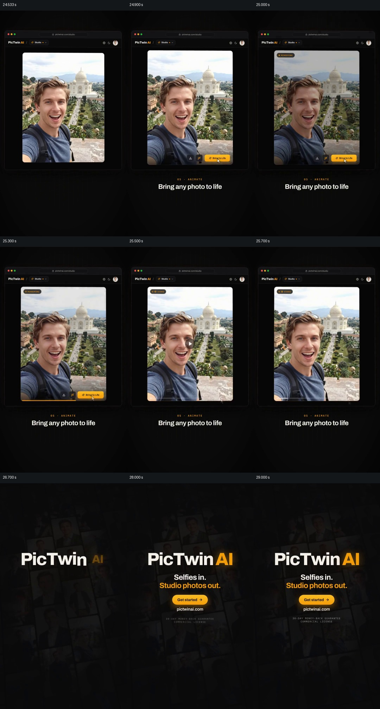

# 让另一张照片经过处理状态，接入产品入口

- 作品：案例 007，自拍与人物图像产品展示（库内案例）。
- 原片范围：24.533–30.000 秒；[完整原片](../video.mp4)｜[本卡片段](c04-20261111.mp4)。含起点、不含终点。
- 观察方式与未确认范围：查看全片 64 帧总览，本段另按 0.2 秒抽查 23.3–25.5 秒源帧并制作本卡九宫格。未独立完成连续原速观看；原片无音轨。细微动作、速度与迁移效果仍待复核。

## 原画面具体怎样设计

约 24.6 秒，网页容器保留，但中心内容换成一张旅行背景中的男子自拍，原先的白底证件照已经退出。下方阶段文字为“05 · ANIMATE”，画面内出现橙色“Bring to Life”按钮；随后的源帧里自拍上方显示“RENDERING”，底部有进度线，约 25.7 秒角上变成“VIDEO”标签。

接着照片及网页让位于由多张人物照片组成的暗背景，中央先出现 PicTwin AI 名称，再出现“Selfies in. Studio photos out.”和橙色开始按钮。最后阶段从可辨认的单张输入，转到片中所声称的输出状态，再把注意力交给统一的品牌入口。

## 为什么这样设计，好在哪里

新照片明确与上一段服装前后对照区分，但沿用网页位置，让观众理解这是相邻的另一项操作。原始自拍在处理和视频标签出现时仍然可辨认，为状态变化提供持续参照；结尾的照片墙再把单张例子接回前面出现过的一组人物作品。

这里可确认的是照片、按钮、处理标签和视频标签的先后源帧；原片无音轨，且未独立连续观看，不能凭截图声称照片内人物完成了怎样的动作，也不能把界面状态当作真实生成任务完成记录。

## 可直接使用的创意指令

当需要展示一份输入进入处理并形成下一步结果时，先独立给出可辨认的材料及与其相连的操作；处理期间保持相同材料或清晰标识，让状态变化有连续参照。结果出现后明确显示它是什么，并给足时间让观众认识，再按需要接一个真实可执行的入口。

照片、素材类型、容器和状态样式可换；必须保留材料身份、处理前后对应和输出状态的区别。如果输出是视频，需实际连续检查其中的运动和声音；单个“视频”标签不能代替播放验证。
