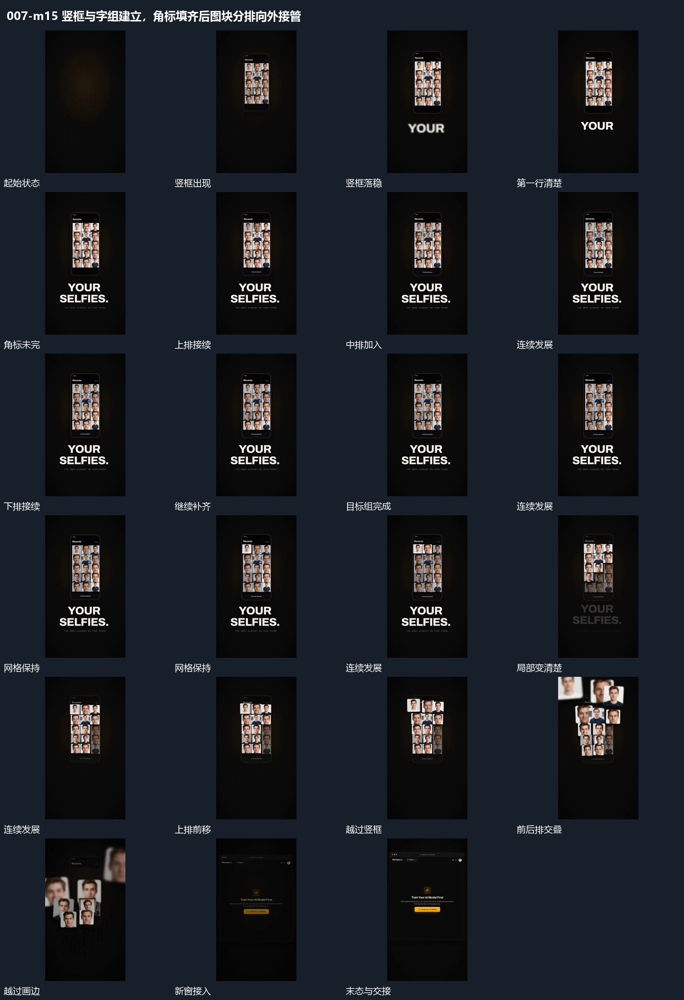

# 竖框与字组建立，角标填齐后图块分排向外接管

## 运动指令

竖框、字组和角标共同建立，完成后图块分排放大，交叠越框并交出画面。

1. **竖框先建立，下方字组错开上移显出**

让底图保持，令竖框从较小尺寸出现并扩大，逐渐落到画面中上部的停留位置。当框接近稳定时，让下方第一行字从模糊到清楚并略微上移；随后让第二行以同样关系接入，再补入更小一行。让已建立的上方框与前面的字行保持，不被后续行推动。完成后保留整组，把运动交给框内角标或图块。

2. **角标按行逐项加入，完成的角标留住**

让竖框、图块网格和下方字组保持，按每行从左到右、再向下一行推进的次序，让图块角落的小角标逐项加入。让已经出现的角标留在对应图块上，不因下一角标进入而移动整张图块。随后只补入指定位置，允许某些图块不增加角标。目标集合完成后保持网格，把下一步动作交给图块本身。

3. **图块按排放大前移，交叠越过框与画面边界**

让竖框先保持，令部分图块减淡，另一些图块逐个变清楚并稍扩大、拉开间距；让下方字组同时减淡。随后让上排图块先向框外移动并持续扩大，越过竖框边界，再越过画面上方或侧边。当上排还没有全部离开时，让中排、下排依次接入同样动作。让更前面的较大图块在离开时变模糊，后排仍继续从框附近出发。最后让旧组减淡，新窗口从底图重新接入。

整段结束：前后各排退去，新窗口可从底图接入。 保留必要落稳与交接，中间已建立的参照沿用到下一步骤。

## 视频切片

[播放本机制的原片切片](m15.mp4)

保留起始准备、连续发展和完成或明确交接；首尾按本段运动范围裁切，不拼接、不变速。相连的小动作合为同一完整段落。

## 分镜过程

## 组合与调整

竖框、字组和角标共同建立，完成后图块分排放大，交叠越框并交出画面。 复用时可调整元素数量、幅度和相对节奏，保留上述进入、交叠与完成关系；不直接沿用原片题材或时长。

可调整框的停留位置、尺度变化幅度、字行数量以及各行之间的错开量。后续框内动作可以提前交叠，但应让框已经具备可定位的边界。

可调整需要角标的图块范围、出现方向和逐项间隔。完成状态由目标集合决定，不必把所有格子都补满；后续图块要退出时，让角标与所属图块一同处理。

可调整按排启动的顺序、扩大幅度、离开方向与排间交叠。各图块有自己的运动，底图保持；若下一窗口不是同一边界连续变化而来，应以独立退去和接入衔接。
