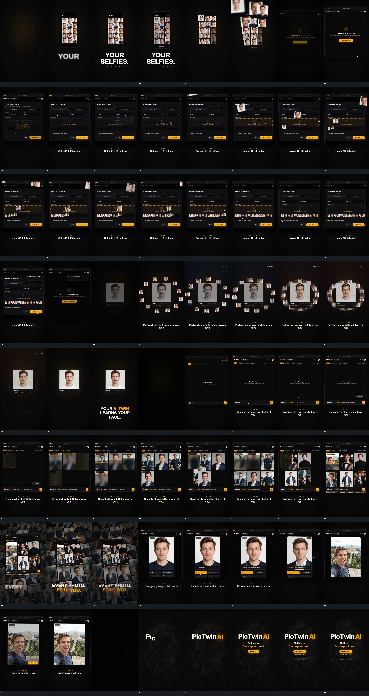

# 007｜原片运动总览

[观看完整原片](video.mp4)

## 运动总览

## 完整运动段落

以下按原片中的出现顺序引用。建立、内部发展及完成反馈放在同一段中；同时发生的局部动作与运镜写在同一份指令里。不同段之间可以是连续接管，也可以是直接切换，不能仅凭条目相邻认定可直接拼接。重复出现的同类运动采用一次连续代表范围，切片不以逐段无缝覆盖整片为目标。

1. [竖框与字组建立，角标填齐后图块分排向外接管](mechanisms/m15.md)：竖框、字组和角标共同建立，完成后图块分排放大，交叠越框并交出画面。

2. [指示符接力展开面板，图块落槽后通知接入并收场](mechanisms/m16.md)：在同一窗口内，指示符定位、列表选择、图块下落和完成反馈连续展开，通知侧入后前景面板让位。

3. [中心卡建立，外围绕行收拢后让出下方字组](mechanisms/m17.md)：中心卡保持，外围建立成环、加速收拢再退出；中心卡留下，下方字组完成最终呈现。

4. [扫描揭示初组，新片接入推动网格让位累积](mechanisms/m18.md)：先在固定窗口中扫清初组，再让新片从左上加入，旧网格让位；扫描与排布在后半段交叠完成。

5. [窗口缩小并倾斜，底层满幅集合接入](mechanisms/m11.md)：前景缩小倾斜与底层出现交叠，各自保留内容。

6. [分界线更换内部画面，底边进度接力后局部活动](mechanisms/m19.md)：外框不重置，分界线先扫过换图，再由底边增长和状态形状的退出接入局部活动。

7. [字符逐项上移落到同一行，下方小组错开补齐](mechanisms/m14.md)：字符建立、下方组加入与底层慢移彼此接续。

切片保留起始准备、必要内部停顿和完成或明确交接；首尾省略无新发展的等待，持续运动不要求人为停住。以上基于真实源帧序列和重点边界核对，不等同于全片连续声画审片。

## 完整64宫格

