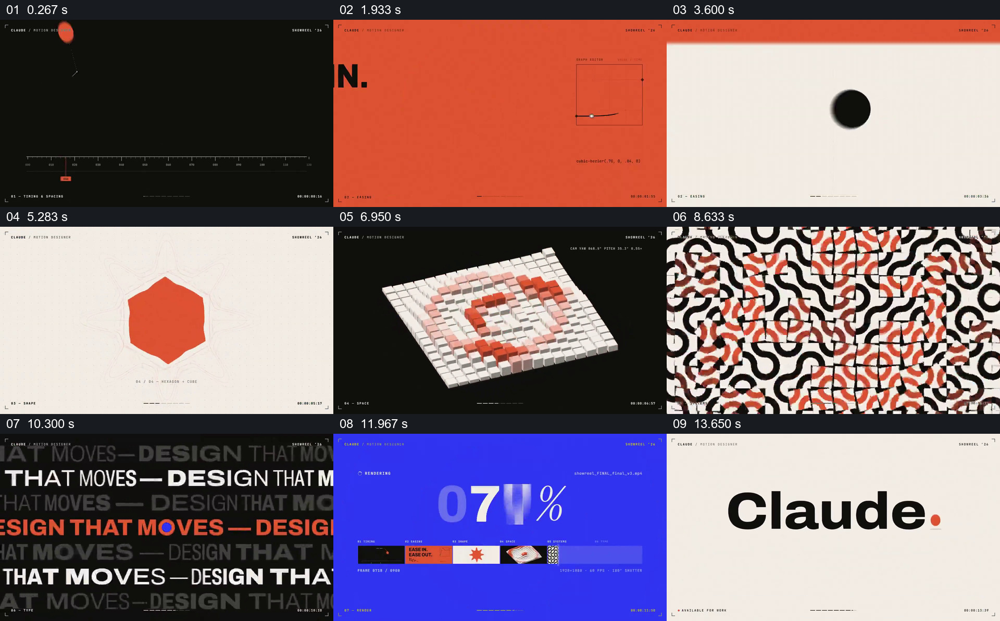
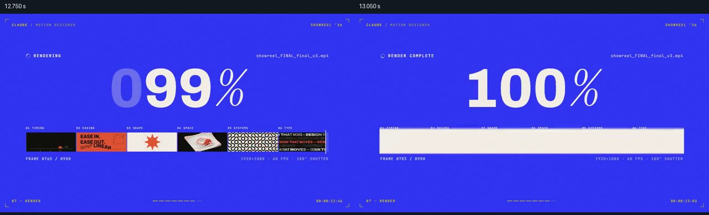

# 把多种视觉实验整理成一条作品进度

- 作品：案例 112。
- 原片范围：00:00.000–00:15.061（源时间，含起点、不含终点）；[完整原片](../video.mp4)｜[本卡片段](../video.mp4)。复用完整原片和同范围分镜。
- 观察方式与未确认范围：核看全片 64 帧总览和本卡九宫格；未独立连续原速观看或听审，抽帧间运动、精确节奏、声音和同步未确认。价值判断为作品分析，跨项目迁移尚未实测。

补充源时间：12.750、13.050 秒。

## 原画面具体怎样设计

画面四角有细小的名称、章节及时间标识。黑底上，一个橙色点与横向时间刻度、曲线图同处一屏；橙色页面接着以“EASE IN / EASE OUT”和曲线说明运动主题。

画面依次转到浅底上的黑圆、蓝色形体和橙色星形，再到黑底的白色立方阵列：部分小立方体升起，橙色构成环状图案。随后黑白曲线纹样与橙色块叠加，重复的“DESIGN THAT MOVES”占满黑底。页边小字和少量统一色彩在不同例子间反复出现。

接近末尾，蓝底出现大号百分比；下方一条横向缩略带依次包含前面图表、图形、立方体和纹样等画面。进度走到 100% 后，画面转为浅底品牌名称。

## 为什么这样设计，好在哪里

这组实验各自材料和图形差异很大，但固定的页角信息、橙黑蓝色系和编号让它们被看作同一个作品集。末尾缩略带不是额外装饰：它把刚看过的局部按顺序放回一条线，解释前面的快切是哪些片段的汇总；进度满格后再显示名称，形成完成感。

这是对排列关系的分析；帧图不能证明具体缓动曲线或每次形态之间连续变形。

## 可直接使用的创意指令

展示多项作品时，准备能独立辨认的少量代表画面，并用固定位置的编号、标题或页边保持同一作品集身份。各项可采用不同媒介和构图，但给观众稳定的颜色、字体或版面参照；在结尾把已出现的画面缩成一条可识别的目录或进度，再交给最终身份。

作品顺序、色彩、进度形式和镜头数可依据内容改变；要保留“先看各项、再回看其集合”的关系。每项需要阅读或解释时应延长其停留，不把快切当成必需条件。
