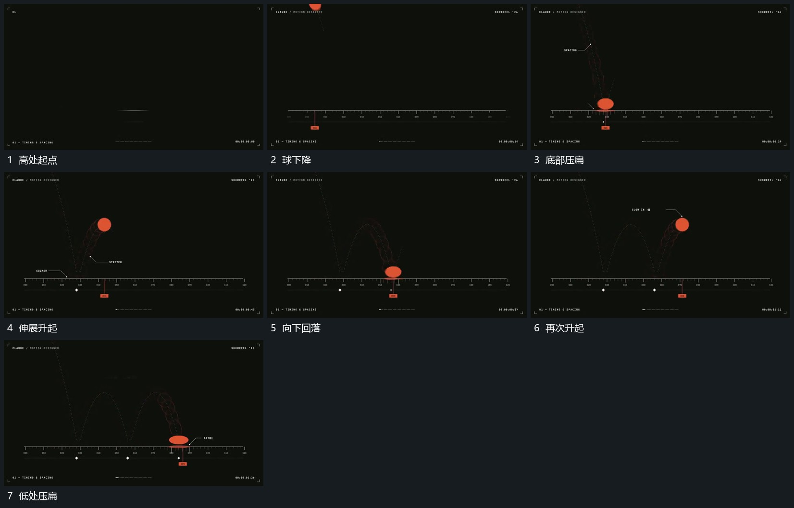

# 球下降压扁伸展后沿前方继续起落

## 运动指令

球向底线下降并略向前移动，接触附近先压低向两侧展开。随后轮廓收窄并抬起，离开底线后恢复较圆形；继续向前下降，下一次落点再压扁，形成连续起落。

## 视频切片

[播放本机制的原片切片](m01.mp4)

覆盖分镜中“高处起点”至“低处压扁”的连续过程，并保留邻近的前后衔接画面；原片中交叠发生的动作一并保留。

## 分镜过程

## 组合与调整

幅度与次数按本片决定；落地、伸展与恢复连为同一过程，不反推物理参数。
