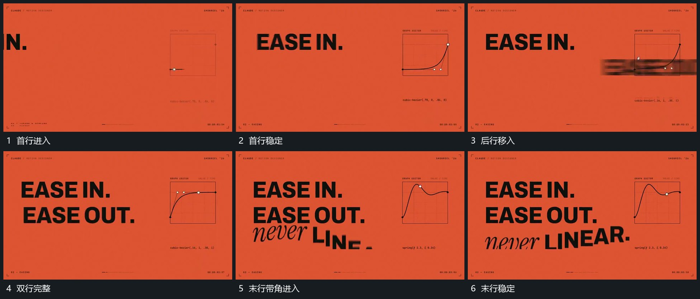

# 字片横向移入分行累积后末行带转角接上

## 运动指令

首行沿横向进入并到位，下一行从相近方向接上，已有行保持。末行带小倾角移入，接近基线后逐步转正，旁侧小框中的曲线随行完成而建立，整组最后保持。

## 视频切片

[播放本机制的原片切片](m02.mp4)

覆盖分镜中“首行进入”至“末行稳定”的连续过程，并保留邻近的前后衔接画面；原片中交叠发生的动作一并保留。

## 分镜过程

## 组合与调整

字片可换几何短组；一行完成附近再接后行，避免全部同刻从一侧挤入。
