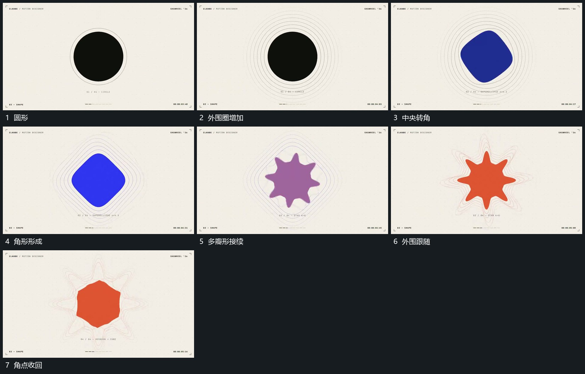

# 中央轮廓转角变形外围轮廓延迟跟上

## 运动指令

中央轮廓围同一中心转角，边缘先从圆滑改成角形，再增加外凸部分。外围细轮廓稍后跟上前一状态，形成不同大小和相位的轮廓层；中央恢复较简单形时外围继续短暂保留余动。

## 视频切片

[播放本机制的原片切片](m03.mp4)

覆盖分镜中“圆形”至“角点收回”的连续过程，并保留邻近的前后衔接画面；原片中交叠发生的动作一并保留。

## 分镜过程

## 组合与调整

保持中心，延迟用于可见跟随关系；不把所有轮廓锁成同一帧同一形态。
