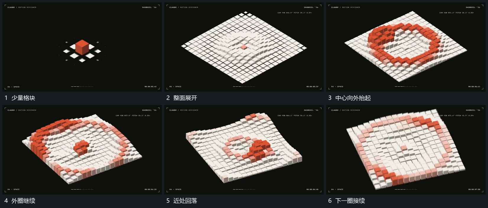

# 少量格块展开整面高度波从中心向外经过

## 运动指令

从中央少量格块向周边扩展排列，完整格面建立后中心附近先增高，相邻圈逐次抬起。近处格块回落时远圈继续经过，形成向外传播的高度变化；格位保持，取景少量转角。

## 视频切片

[播放本机制的原片切片](m04.mp4)

覆盖分镜中“少量格块”至“下一圈接续”的连续过程，并保留邻近的前后衔接画面；原片中交叠发生的动作一并保留。

## 分镜过程

## 组合与调整

波动由近到远接力，不能整面同步抬起；可减少格数保持过程清楚。
