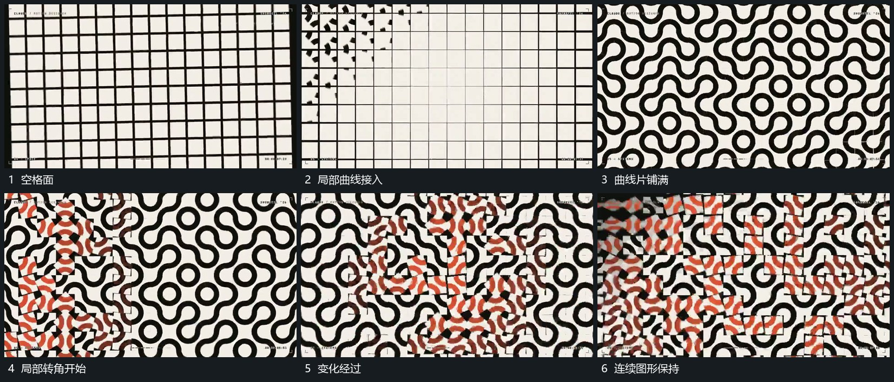

# 格位内曲线片逐项描入局部转角沿面传递

## 运动指令

保持格位范围，从局部开始描出弯曲线片，再逐项填向邻格，使相邻线片端部可相接。完成后局部格片改变倾角或尺度，附近格位稍后接上，变化沿面经过，已过区域恢复。

## 视频切片

[播放本机制的原片切片](m05.mp4)

覆盖分镜中“空格面”至“连续图形保持”的连续过程，并保留邻近的前后衔接画面；原片中交叠发生的动作一并保留。

## 分镜过程

## 组合与调整

新片可换简单线片，保留格位和先后；不声称源片采用某种生成算法。
