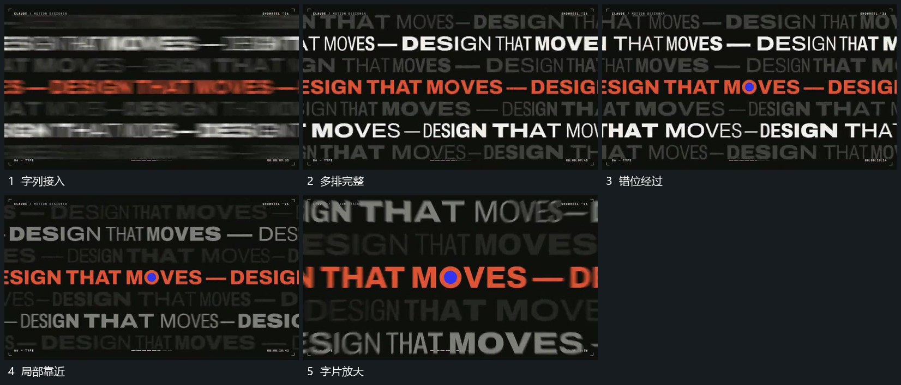

# 多排长字错开横向经过再逐步靠近

## 运动指令

多排长字沿横向经过，不同排错开起点和位移幅度，重点排保持较清楚范围。取景逐步靠近其中局部，使字片放大并越过边界，其他排仍在后方经过；最后由覆盖边界接下一层。

## 视频切片

[播放本机制的原片切片](m06.mp4)

覆盖分镜中“字列接入”至“字片放大”的连续过程，并保留邻近的前后衔接画面；原片中交叠发生的动作一并保留。

## 分镜过程

## 组合与调整

排数可以减少；各排有相对运动，推近不能只把静态排图统一放大。
