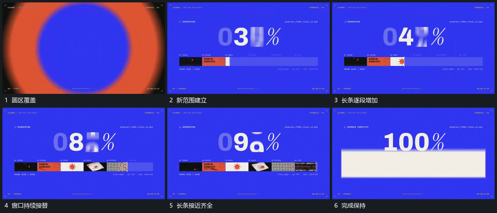

# 圆区覆盖后长条逐段累积窗口内竖向接替

## 运动指令

侧方圆区扩大覆盖后建立新底。下方长条从一端逐段累积，每段完成后保留内部小图；上方固定窗口同时让短片竖向接替。长条填齐后窗口也停到稳定结果，最后中央宽片接入下一主行。

## 视频切片

[播放本机制的原片切片](m07.mp4)

覆盖分镜中“圆区覆盖”至“完成保持”的连续过程，并保留邻近的前后衔接画面；原片中交叠发生的动作一并保留。

## 分镜过程

## 组合与调整

不继承原百分比或进度含义；两范围各自连续，结果不需要真实计算。
