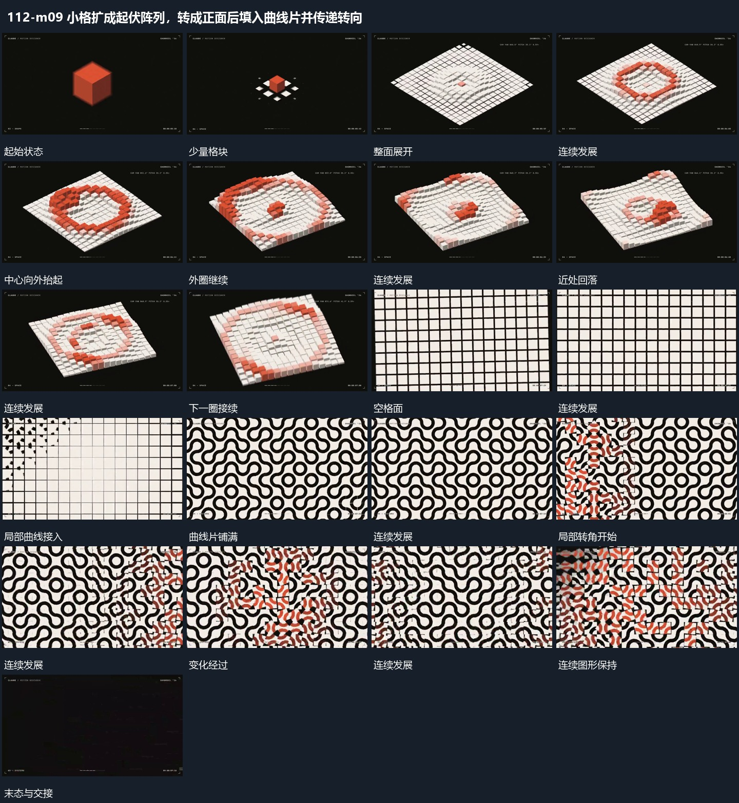

# 小格扩成起伏阵列，转成正面后填入曲线片并传递转向

## 运动指令

少量小格向外补成整面，局部高度波从中心向外传递；取景转至正面，格内曲线片依次填入，局部旋转继续沿阵列传递。

1. **少量格块展开整面高度波从中心向外经过**

从中央少量格块向周边扩展排列，完整格面建立后中心附近先增高，相邻圈逐次抬起。近处格块回落时远圈继续经过，形成向外传播的高度变化；格位保持，取景少量转角。

2. **格位内曲线片逐项描入局部转角沿面传递**

保持格位范围，从局部开始描出弯曲线片，再逐项填向邻格，使相邻线片端部可相接。完成后局部格片改变倾角或尺度，附近格位稍后接上，变化沿面经过，已过区域恢复。

整段结束：连续曲线片铺满并活动 保留必要落稳与交接，中间已建立的参照沿用到下一步骤。

## 视频切片

[播放本机制的原片切片](m09.mp4)

保留起始准备、连续发展和完成或明确交接；首尾按本段运动范围裁切，不拼接、不变速。相连的小动作合为同一完整段落。

## 分镜过程

## 组合与调整

少量小格向外补成整面，局部高度波从中心向外传递；取景转至正面，格内曲线片依次填入，局部旋转继续沿阵列传递。 复用时可调整元素数量、幅度和相对节奏，保留上述进入、交叠与完成关系；不直接沿用原片题材或时长。

波动由近到远接力，不能整面同步抬起；可减少格数保持过程清楚。

新片可换简单线片，保留格位和先后；不声称源片采用某种生成算法。
