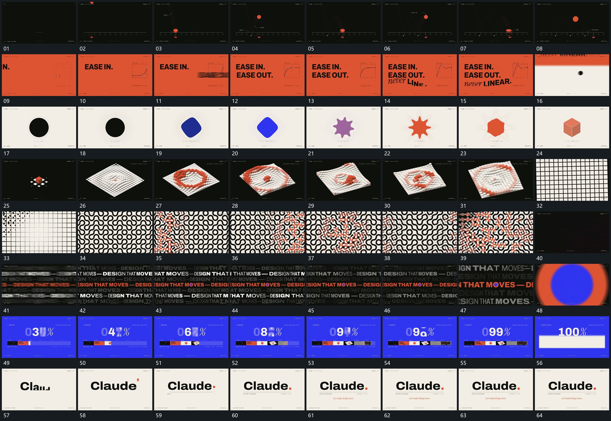

# 112｜原片运动总览

[观看完整原片](video.mp4)

## 运动总览

全片由球下降压扁伸展后沿前方继续起落让球下降、压扁、伸展并再次起落，接到字片横向移入分行累积后末行带转角接上的分行字片移入。随后中央轮廓转角变形外围轮廓延迟跟上让中央轮廓转角变形，外围细轮廓稍后跟上。

空间阵列段少量格块展开整面高度波从中心向外经过从中央少量格块展开整面，再让高度波动向外经过；格位内曲线片逐项描入局部转角沿面传递在格位内逐步描出曲线片段，并让局部转角形成面内经过。后段多排长字错开横向经过再逐步靠近让多排长字错开经过再放大接近，圆区覆盖后长条逐段累积窗口内竖向接替通过圆区覆盖进入长条累积与窗口内接替。结尾主行逐段显露小点落到末端下线再展开建立主行、行末点和附属行，原底保持。

## 完整运动段落

以下按原片中的出现顺序引用。建立、内部发展及完成反馈放在同一段中；同时发生的局部动作与运镜写在同一份指令里。不同段之间可以是连续接管，也可以是直接切换，不能仅凭条目相邻认定可直接拼接。重复出现的同类运动采用一次连续代表范围，切片不以逐段无缝覆盖整片为目标。

1. [球下降压扁伸展后沿前方继续起落](mechanisms/m01.md)：下降压缩抬起接续

2. [字片横向移入分行累积后末行带转角接上](mechanisms/m02.md)：移入累积末行收势

3. [中央轮廓转角变形外围轮廓延迟跟上](mechanisms/m03.md)：中心先变外围后跟随

4. [小格扩成起伏阵列，转成正面后填入曲线片并传递转向](mechanisms/m09.md)：少量小格向外补成整面，局部高度波从中心向外传递；取景转至正面，格内曲线片依次填入，局部旋转继续沿阵列传递。

5. [多排长字错开横向经过再逐步靠近](mechanisms/m06.md)：错位经过与推近交叠

6. [圆区覆盖后长条逐段累积窗口内竖向接替](mechanisms/m07.md)：覆盖后逐段累积并行接替

7. [主行逐段显露小点落到末端下线再展开](mechanisms/m08.md)：字行显露小点落定下线接续

切片保留起始准备、必要内部停顿和完成或明确交接；首尾省略无新发展的等待，持续运动不要求人为停住。以上基于真实源帧序列和重点边界核对，不等同于全片连续声画审片。

## 完整64宫格

