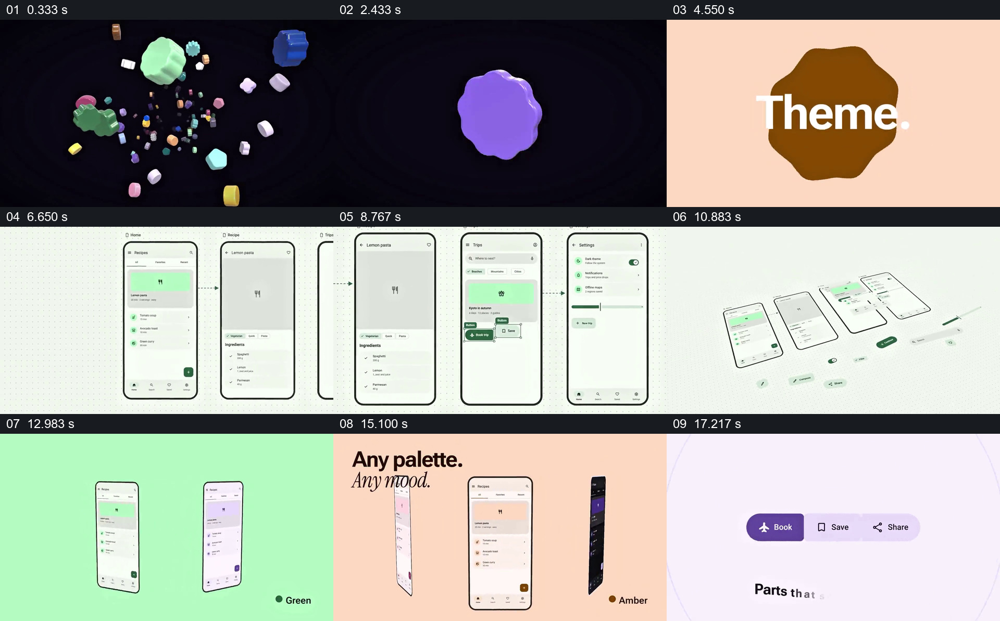

# 从组件群到一组手机页面，再比较不同配色

- 作品：案例 047《组件画布与移动界面》（索引名称）。
- 原片范围：00:00.000–00:19.000，含起点、不含终点；[完整原片](../video.mp4)｜[本卡片段](c01.mp4)。
- 观察方式：依据整片 64 宫格和约每秒一次的真实源帧观察，未连续原速观看；原片音轨解码采样全为零，完整播放节奏未确认。

## 原画面具体怎样设计

黑色背景里大量彩色立体形状聚集，出现 M3E Canvas 标识；浅色画面中多部手机页面以箭头连接，随后页面及按钮拆开排列。同一手机界面依次呈现绿色、蓝色、橙色和深色版本，最后显示几个按钮组件。

## 为什么这样设计，好在哪里

同一页面的内容保持可辨，让配色差异成为主要比较对象；多屏与拆开的组件呈现整体和局部之间的关系。画面不能证明组件系统或主题切换实际可用。

以上为依据画面的分析，非作者自述；预期观看效果未经观众测试。

## 可直接使用的创意指令

介绍界面组件时，选择实际页面及其组成元素，先展示页面之间的关系，再把必要组件与对应页面放在一起；用相同内容比较真实可用的主题，核实对比度及交互状态。
