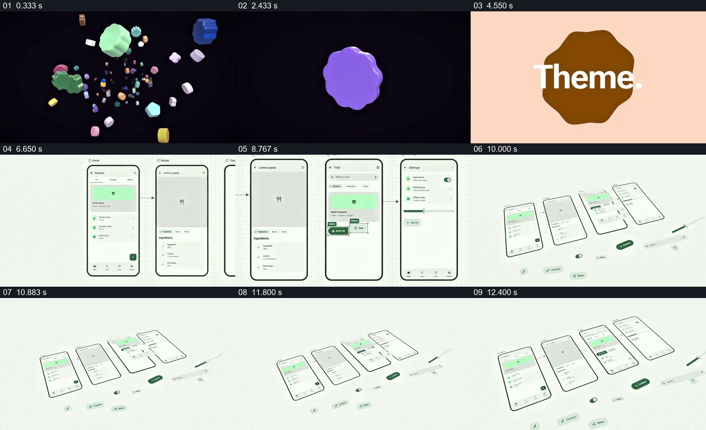

# 从空间中的零件进入多屏画布，再把组件展开

- 作品：案例 047《多手机与色彩主题》（库内索引名）。
- 原片范围：00:00.000–00:12.800，含起点、不含终点；[完整原片](../video.mp4)｜[本卡片段](c01-20261111.mp4)，片段起点对应原片 0.000 秒。
- 范围依据：从彩色空间与产品标识开始，到多屏及其组件在斜向画布中展开；12.8 秒起切入另一种配色比较。
- 观察方式：核看全片 64 帧总览及本卡九宫格，并核看场景边界附近每 0.2 秒源帧；未独立连续原速观看，快速变化和运动节奏待核。原片音轨全部 2,838,528 个浮点采样均为零，未独立听审。片中事实和演示未独立查证，新题材迁移尚未实测。

## 原画面具体怎样设计

黑色空间里散布大小、颜色、远近不同的立体小形状；一个紫色形状被留下，接成产品标识和名称。随后几块有机形状与简短词语出现在浅色画面中，再切到浅色点阵画布。

画布中并列多部手机页面：食谱列表、食谱详情、出行页面及设置页等以箭头关联。页面内部有图像占位、文字、按钮和开关；部分控件周围出现可见边框和标签。之后观察角度改变，原来正面的多个屏幕变成远近有序的斜向排列，按钮、开关及小标签在屏幕下方被分离出来，仍与整体一起停留。随后画面开始切入多配色对照。

## 为什么这样设计，好在哪里

黑底散块先把“组件”做成可感知的空间集合，接着用整齐的多屏画布表明这些局部可以组成相互关联的页面；当视角由正面转为斜向、组件被提出，观众既能看到整体结构，又能辨认它的可复用单元。箭头与页面内容提供关系，而不只是把几张手机截图摆在一起。若缺少整体画布，只看到零件难以理解其用途；如果拆出的按钮无法回指页面，整体与局部也会失去联系。以上是画面设计分析，不能证明软件真的按这种方式生成界面。

## 可直接使用的创意指令

需要展示一个由多部分构成的系统时，准备真实页面或经过标注的示意页面，以及其中实际使用的组件。先用可识别的零件集合引出主题，再按用户路径排列若干页面并用必要连线说明关系；等整体被看清后改变观察角度或拉开空间，将关键组件从原位置提出，并保留其所属页面作为参照。对象数量、画幅与空间风格由项目决定，连接应反映真实页面关系，不把美术拆解冒充可运行的交互实现。
