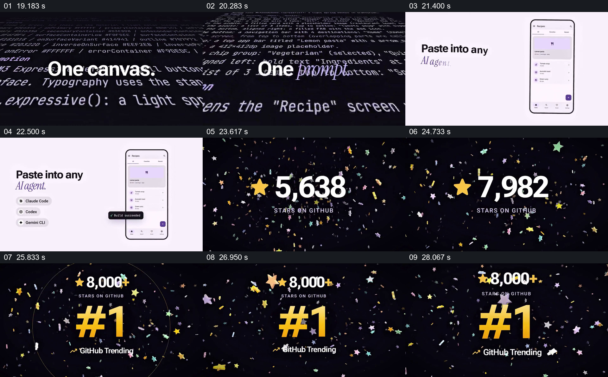

# 将提示词示意与结果、项目规模并置

- 作品：案例 047《组件画布与移动界面》（索引名称）。
- 原片范围：00:19.000–00:29.000，含起点、不含终点；[完整原片](../video.mp4)｜[本卡片段](c02.mp4)。
- 观察方式：依据整片 64 宫格和约每秒一次的真实源帧观察，未连续原速观看；原片音轨解码采样全为零，完整播放节奏未确认。

## 原画面具体怎样设计

黑底代码画面写“One canvas. One prompt.”；随后浅色画面出现“Paste into any AI agent.”和手机界面。深色背景上星标数量增长至 8,000+，接着出现 GitHub Trending 排名。

## 为什么这样设计，好在哪里

将输入和可见界面相邻排列，帮助理解工具主张；规模数字另行成为观看重点。示意画面未证明输入直接生成结果，数字和排行未经核实。

以上为依据画面的分析，非作者自述；预期观看效果未经观众测试。

## 可直接使用的创意指令

当介绍文本驱动的界面工作流时，展示真实输入、执行条件与可复核输出，必要时保留中间修改；项目指标需给出来源、时间和统计口径，不用动画增长暗示未经证实的效果。
