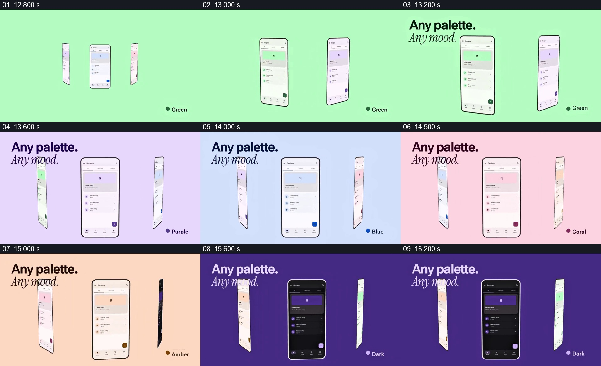

# 让同一界面转到中央，依次比较多种配色

- 作品：案例 047《多手机与色彩主题》（库内索引名）。
- 原片范围：00:12.800–00:16.600，含起点、不含终点；[完整原片](../video.mp4)｜[本卡片段](c02-20261111.mp4)，片段起点对应原片 12.800 秒。
- 范围依据：从绿色主题与三部设备建立，到深色主题居中完成比较；之后切换到按钮排列示意。
- 观察方式：核看全片 64 帧总览及本卡九宫格，并核看场景边界附近每 0.2 秒源帧；未独立连续原速观看，快速变化和运动节奏待核。原片音轨全部 2,838,528 个浮点采样均为零，未独立听审。片中事实和演示未独立查证，新题材迁移尚未实测。

## 原画面具体怎样设计

浅绿色背景里，几部纵向手机以不同角度并列，中央一部正面显示相同的食谱列表，旁边的设备以接近侧面的姿态留在两边。左上写 “Any palette. Any mood.”，右下为对应配色名称。

后续抽样状态显示中央页面结构保持相近，背景、界面强调色和右下名称依次换成紫、蓝、珊瑚、琥珀及深色等版本；侧面设备同时构成仍有其他方案的空间参照。最后深色页面居中，下一段变为单独的按钮组。抽帧不足以确定转动速度和逐帧接力细节。

## 为什么这样设计，好在哪里

比较时把页面内容和主要位置保持相对稳定，差异就集中在配色，而不是每次都要重新理解一个不同界面。中央正对的设备承担当前比较对象，两侧侧立的设备提示还有其他版本，背景与标签让当前主题更容易识别。若每个版本内容和布局都不同，观众难以判断变化究竟来自配色还是内容；必须保留相同主体和可读页面，具体三部设备及颜色并非必要。以上是基于画面的分析，不等于真实主题功能或可访问性通过。

## 可直接使用的创意指令

比较同一设计的多个视觉版本时，先固定真实内容、结构、视角和对比对象，选择有实际意义的几套方案。每次把一套放到主要阅读位置，保留其他版本的轻量参照，并以简短标签标明当前版本；保证文字和界面元素在每个版本中都能读清。背景、设备数量和切换方式可以改变，但不应同时更换内容、尺度与结构而使比较失去基准；实际采用前需检查不同主题的对比度及状态。
