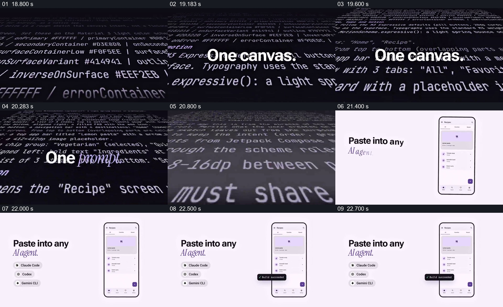

# 把一段文字输入的主张接到可见界面示例

- 作品：案例 047《多手机与色彩主题》（库内索引名）。
- 原片范围：00:18.800–00:22.800，含起点、不含终点；[完整原片](../video.mp4)｜[本卡片段](c03-20261111.mp4)，片段起点对应原片 18.800 秒。
- 范围依据：从代码与提示词背景进入，到手机示例、代理名称和完成提示出现；22.8 秒后转入项目指标动画。
- 观察方式：核看全片 64 帧总览及本卡九宫格，并核看场景边界附近每 0.2 秒源帧；未独立连续原速观看，快速变化和运动节奏待核。原片音轨全部 2,838,528 个浮点采样均为零，未独立听审。片中事实和演示未独立查证，新题材迁移尚未实测。

## 原画面具体怎样设计

深色背景铺满透视倾斜的代码或提示文字，前景依次出现 “One canvas.” 和 “One prompt.”，两种字体强调主句中的不同部分。随后换到浅色背景，左侧写 “Paste into any AI agent.”，下方列出 Claude Code、Codex 和 Gemini CLI 的名称；右侧是一部显示食谱列表的手机。手机前出现 “Build succeeded” 小提示，随后画面切到深色背景中的项目星标。

屏幕展示的是宣传性示意：看不到完整输入、执行过程与可复核输出，不能据此认定某条提示已经由这些工具成功生成该页面。

## 为什么这样设计，好在哪里

密集文本提供输入内容的视觉语境，前景短句在复杂背景上形成阅读重点；换到浅色后，工具名称与具体界面例子分处左右，观众能把抽象主张和可见成品联系起来。建立这种联系依赖明确的输入、执行与结果证据；原片只提供概念上的并置，不能视为技术验证。若新作品需要证明实际生成，必须补足中间操作和产物来源。

## 可直接使用的创意指令

介绍由文本驱动的工具时，先明确一个具体任务和真实输入，可用局部文字或代码作为背景，但在前景用一句容易阅读的短语指出任务；随后把执行环境、真实输入与对应的实际结果并置，必要时展示中间修改、运行状态和结果来源。手机外壳、代理名称或成功提示不能代替证据；若只有概念示意，应明确标注，不能暗示已经完成或支持未验证的工具。
